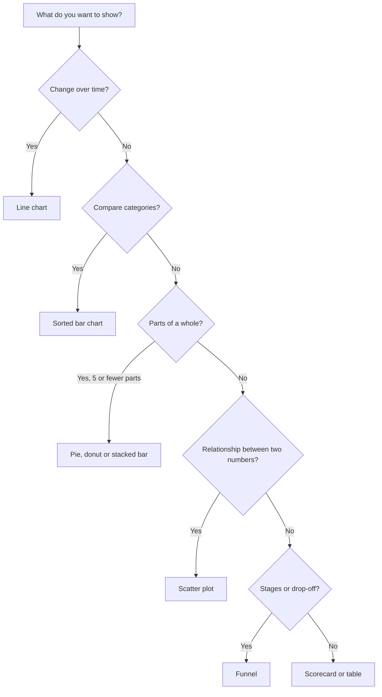
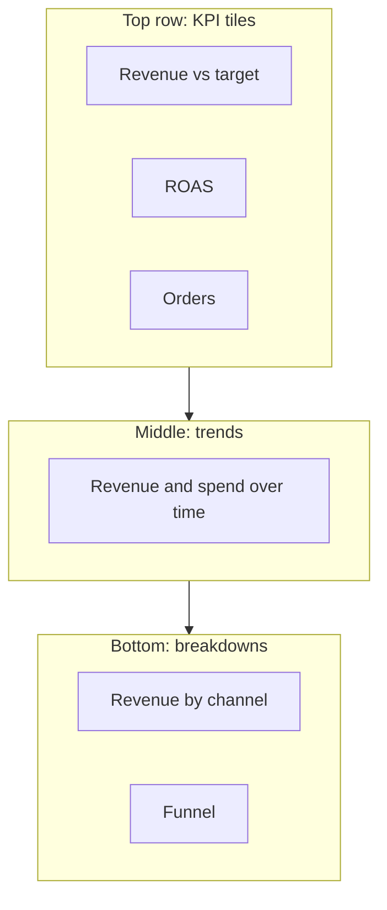
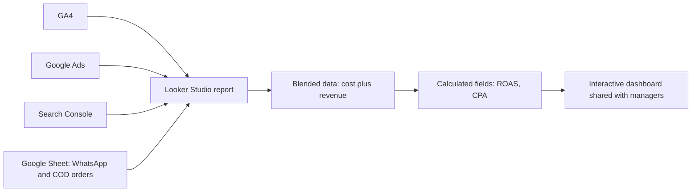
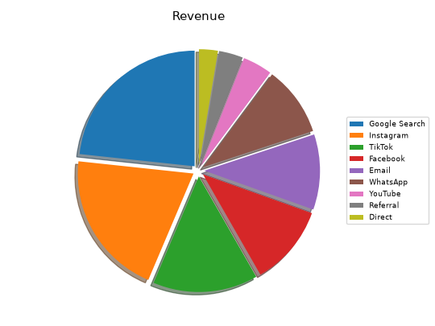
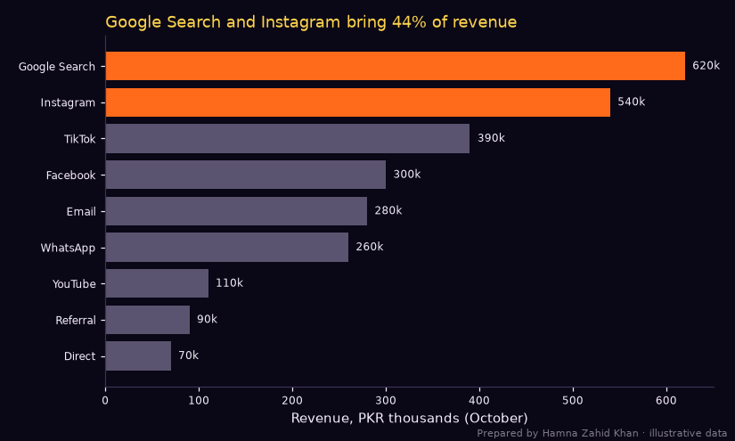
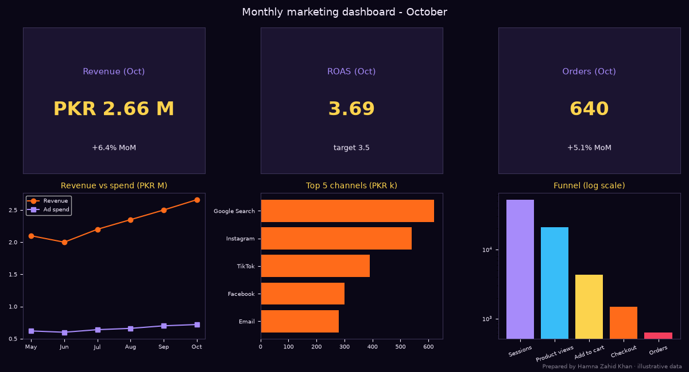

# Session 5 · Visualizing Marketing Data Effectively

> 🏠 [Diploma in Digital Marketing](../../README.md) › [Term 1](../README.md) › [Analytics](README.md) › **Session 5**
>
> ⏱ **Estimated time:** 3 hours (1.5 h theory + 1.5 h lab) · 📋 **Prerequisites:** Sessions 1-4

[⬅ Previous: Session 4](session-04-social-metrics-and-engagement.md) · [Next: Analytics practice test ➡](practice-test.md)

---

## 🎯 Learning objectives

By the end of this session you will be able to:

- Define the purpose of **data visualisation** in marketing and summarise how to **choose the right chart** for a question.
- Explain the main **types of visualisations** and their best uses, including dashboards.
- Apply **design principles** – clarity, honesty, highlighting, accessibility – and fix a misleading chart.
- Illustrate how **Looker Studio** (formerly Google Data Studio) connects data sources and builds interactive dashboards.
- Build charts and a marketing dashboard in Python and tell a clear data story.

## 📖 Concepts

### 1. Why visualise?

People spot patterns in pictures far faster than in tables. Good visualisation helps marketers **see trends, compare options, find problems and persuade decision makers**. Bad visualisation hides insights or misleads.

> 💡 A dashboard is a car's instrument panel: a few dials (speed, fuel, warning lights) you can read at a glance – not every reading the engine produces.

### 2. Choosing the right chart

Start from the **question**, not the chart type:

| Question | Best chart | Avoid |
|---|---|---|
| How does a metric change over time? | **Line chart** (or column for few periods) | Pie |
| How do categories compare? | **Bar chart** (horizontal for long labels), sorted | 3-D bars |
| What is the composition of a whole? | **Stacked bar**, or a **pie/donut with ≤ 5 slices** | Pie with 9 slices |
| What is the relationship between two variables? | **Scatter plot** (bubble for a third) | Line |
| How is a variable distributed? | **Histogram** or box plot | Pie |
| Where do people drop out? | **Funnel** chart or bar of stages | Line |
| When/where is activity highest? | **Heat-map** (day × hour, region × product) | Many small pies |
| Where geographically? | **Map** (filled or bubble) | Table only |
| How are we doing vs target right now? | **Scorecard / KPI tile**, bullet chart, gauge | Big tables |
| Exact values needed? | **Table** with conditional formatting | Charts with unreadable labels |

### 3. Design principles

| Principle | Practice |
|---|---|
| **One message per chart** | The title states the insight: "Search and Instagram bring 44% of revenue" |
| **Sort meaningfully** | Bars from largest to smallest (unless there's a natural order like months) |
| **Highlight what matters** | One accent colour for the key bars, grey for the rest |
| **Direct labels** | Put values and names on the chart instead of a legend to look up |
| **Honest axes** | Bar charts start at zero; label units; don't use dual axes that exaggerate |
| **Remove clutter** | No 3-D, shadows, heavy gridlines or decorative backgrounds |
| **Consistent colours** | The same channel has the same colour in every chart |
| **Accessibility** | Sufficient contrast; don't rely on red/green alone (colour-blindness); readable font sizes |
| **Context** | Show targets, previous period or benchmarks |
| **Annotate** | Mark events: "Eid campaign starts", "site outage" |

### 4. Misleading charts to recognise

| Trick | Effect | Fix |
|---|---|---|
| Truncated y-axis on bars | Small differences look huge | Start bars at zero |
| 3-D pies | Front slices look bigger | Flat bar chart |
| Cherry-picked date range | Hides a decline | Show full period with context |
| Too many categories in a pie | Unreadable | Bar chart; group small ones as "Other" |
| Cumulative charts that always rise | Hide a slowdown | Show period values too |
| Different scales on side-by-side charts | False comparisons | Same scale or clear labels |

### 5. Dashboards

A **dashboard** is a single view of the KPIs that matter for a goal, refreshed automatically.

| Dashboard type | Audience | Contents |
|---|---|---|
| **Strategic / executive** | Owner, managers | Revenue, ROAS/ROI, orders, trend vs target – monthly |
| **Operational** | Campaign managers | Spend, CPA, CTR by campaign – daily |
| **Analytical** | Analysts | Filters, segments, drill-downs for investigation |

**Layout rules:** most important KPIs top-left (people read in a Z/F pattern), KPI tiles on top, trends in the middle, breakdowns below, filters for date/channel/device, no more than ~6–8 visuals per page, consistent colours, and a short "What changed and what we'll do" note.

### 6. Looker Studio (formerly Google Data Studio)

**Looker Studio** is Google's free tool for interactive reports and dashboards.

| Concept | Meaning |
|---|---|
| **Data source / connector** | Link to GA4, Google Ads, Search Console, Google Sheets, BigQuery, YouTube and many partner connectors |
| **Report** | Pages with charts, scorecards, tables, text and images |
| **Dimension** | A category to group by (source, campaign, device, date) |
| **Metric** | A number to measure (sessions, conversions, revenue) |
| **Controls** | Date-range picker, drop-down filters for viewers |
| **Calculated field** | Your own formula, e.g. `ROAS = Revenue / Cost` |
| **Blending** | Join two sources (e.g. Ads cost + GA4 revenue) on a shared key such as date or campaign |
| **Sharing** | Share like a Google Doc (view/edit), schedule email delivery |

**Building a dashboard step by step:**

1. Go to lookerstudio.google.com → **Create → Report**.
2. **Add data:** choose the GA4 connector → select your property. Add Google Ads and a Google Sheet of offline/WhatsApp orders as further sources.
3. **Add scorecards:** Sessions, Key events, Revenue; enable comparison to the previous period.
4. **Add a time-series chart:** dimension Date, metrics Sessions and Key events.
5. **Add a bar chart:** dimension Session source/medium, metric Revenue, sorted descending.
6. **Create a calculated field** in a blended source: `ROAS = Revenue / Cost`.
7. **Add controls:** date range, device category, campaign.
8. **Style:** brand colours, consistent channel colours, titles that state the insight.
9. **Share** with the manager (view only) and schedule a weekly PDF email.

Alternatives: **Power BI**, **Tableau**, Excel/Sheets charts, and Python (matplotlib, Plotly) for custom analysis.

### 7. Data storytelling

A good data story has three parts:

1. **Context** – what question we asked and why it matters.
2. **Insight** – what the data shows (one or two key charts, clearly titled).
3. **Action** – what we recommend, with expected impact.

> "Mobile brings 84% of visits but converts at half the desktop rate (chart). Recordings show the checkout button is hidden on small screens. Fixing it should add ~200 orders a month."

## 🧭 Diagrams

### Chart chooser



### Dashboard layout



### Looker Studio data flow



## 💻 Worked examples

### Example 1 – Chart makeover and a dashboard

The same revenue-by-channel data shown badly and well, plus a four-panel monthly dashboard:

📄 `code/session-05_chart_makeover.py`

```python
# Data visualisation: a bad chart vs a good chart for the same data, plus a 4-panel marketing
# dashboard. Prepared by Hamna Zahid Khan, Junior Lecturer. Illustrative monthly data (PKR).
import matplotlib
matplotlib.use("Agg")
import matplotlib.pyplot as plt

BG, FIRE, GOLD, VIOLET, EMBER, TEXT = "#0A0716", "#FF6B1A", "#FCD34D", "#A78BFA", "#F43F5E", "#F5EEFF"
channels = ["Google Search", "Instagram", "TikTok", "Facebook", "Email", "WhatsApp", "YouTube", "Referral", "Direct"]
revenue = [620, 540, 390, 300, 280, 260, 110, 90, 70]   # PKR thousands

# BAD: 3-D-style pie with 9 slices, legend lookup, no sorting, no numbers
fig, ax = plt.subplots(figsize=(6, 4.5))
ax.pie(revenue, labels=None, startangle=90, shadow=True, explode=[0.05] * 9)
ax.legend(channels, loc="center left", bbox_to_anchor=(1, .5), fontsize=7)
ax.set_title("Revenue")
plt.tight_layout(); plt.savefig("session-05_bad_chart.png", dpi=90)

# GOOD: sorted horizontal bars, direct labels, highlight, clear title with the insight
fig, ax = plt.subplots(figsize=(7.5, 4.5), facecolor=BG); ax.set_facecolor(BG)
order = sorted(zip(revenue, channels))
vals, names = zip(*order)
cols = [FIRE if n in ("Google Search", "Instagram") else "#5b5470" for n in names]
bars = ax.barh(names, vals, color=cols)
for b, v in zip(bars, vals): ax.text(v + 8, b.get_y() + b.get_height() / 2, f"{v}k", va="center", color=TEXT, fontsize=8)
ax.set_title("Google Search and Instagram bring 44% of revenue", color=GOLD, loc="left")
ax.set_xlabel("Revenue, PKR thousands (October)", color=TEXT)
ax.tick_params(colors=TEXT, labelsize=8)
for side in ("top", "right"): ax.spines[side].set_visible(False)
for side in ("left", "bottom"): ax.spines[side].set_color("#3b3355")
fig.text(0.99, 0.01, "Prepared by Hamna Zahid Khan · illustrative data", color=TEXT, alpha=0.5, ha="right", fontsize=7)
plt.tight_layout(); plt.savefig("session-05_good_chart.png", dpi=110, facecolor=BG)
share = (620 + 540) / sum(revenue) * 100
print(f"Top-2 share check: (620 + 540) / {sum(revenue)} = {share:.1f}%")

# DASHBOARD: KPI tiles + trend + channel mix + funnel
months = ["May", "Jun", "Jul", "Aug", "Sep", "Oct"]
rev = [2.1, 2.0, 2.2, 2.35, 2.5, 2.66]; spend = [0.62, 0.6, 0.64, 0.66, 0.7, 0.72]
fig = plt.figure(figsize=(12, 6.5), facecolor=BG)
gs = fig.add_gridspec(2, 3)
tiles = [("Revenue (Oct)", "PKR 2.66 M", "+6.4% MoM"), ("ROAS (Oct)", f"{rev[-1] / spend[-1]:.2f}", "target 3.5"), ("Orders (Oct)", "640", "+5.1% MoM")]
for i, (t, v, d) in enumerate(tiles):
    ax = fig.add_subplot(gs[0, i]); ax.set_facecolor("#1b1430"); ax.set_xticks([]); ax.set_yticks([])
    for s in ax.spines.values(): s.set_color("#3b3355")
    ax.text(.5, .68, t, ha="center", color=VIOLET, fontsize=11, transform=ax.transAxes)
    ax.text(.5, .4, v, ha="center", color=GOLD, fontsize=24, weight="bold", transform=ax.transAxes)
    ax.text(.5, .16, d, ha="center", color=TEXT, fontsize=9, transform=ax.transAxes)
ax = fig.add_subplot(gs[1, 0]); ax.set_facecolor(BG)
ax.plot(months, rev, color=FIRE, marker="o", label="Revenue"); ax.plot(months, spend, color=VIOLET, marker="s", label="Ad spend")
ax.set_title("Revenue vs spend (PKR M)", color=GOLD, fontsize=10); ax.legend(facecolor=BG, labelcolor=TEXT, fontsize=7)
ax2 = fig.add_subplot(gs[1, 1]); ax2.set_facecolor(BG)
ax2.barh(list(names[-5:]), list(vals[-5:]), color=FIRE); ax2.set_title("Top 5 channels (PKR k)", color=GOLD, fontsize=10)
ax3 = fig.add_subplot(gs[1, 2]); ax3.set_facecolor(BG)
stages, cnt = ["Sessions", "Product views", "Add to cart", "Checkout", "Orders"], [52000, 21000, 4300, 1500, 640]
ax3.bar(stages, cnt, color=[VIOLET, "#38BDF8", GOLD, FIRE, EMBER]); ax3.set_yscale("log"); ax3.set_title("Funnel (log scale)", color=GOLD, fontsize=10)
for a in (ax, ax2, ax3):
    a.tick_params(colors=TEXT, labelsize=7)
    for s in a.spines.values(): s.set_color("#3b3355")
ax3.set_xticks(range(5)); ax3.set_xticklabels(stages, rotation=20)
fig.suptitle("Monthly marketing dashboard - October", color=TEXT, fontsize=13)
fig.text(0.99, 0.01, "Prepared by Hamna Zahid Khan · illustrative data", color=TEXT, alpha=0.5, ha="right", fontsize=7)
plt.tight_layout(); plt.savefig("session-05_dashboard.png", dpi=100, facecolor=BG)
print("Saved session-05_bad_chart.png, session-05_good_chart.png, session-05_dashboard.png")
```

**Output**

```text
Top-2 share check: (620 + 540) / 2660 = 43.6%
Saved session-05_bad_chart.png, session-05_good_chart.png, session-05_dashboard.png
```

**Before:** a shadowed, exploded pie with nine slices and a legend you have to match by colour – you can't tell whether Instagram or Google Search is larger, and there's no message.



**After:** a sorted horizontal bar chart with direct labels, two highlighted bars and a title that states the insight.



**Dashboard:** KPI tiles (revenue, ROAS vs target, orders), a revenue-vs-spend trend, top channels and a funnel on a log scale (so small later stages remain visible).



### Example 2 – Choosing charts for a monthly report (walkthrough)

| Report question | Chart | Why |
|---|---|---|
| Are we on track for the monthly revenue target? | Scorecard with % of target | One number, instant read |
| How did sessions trend over 6 months? | Line chart with Eid annotated | Time + context |
| Which channels drive revenue? | Sorted bar chart | Category comparison |
| How do new vs returning customers split revenue? | Stacked bar or 2-slice donut | Simple composition |
| Is spend related to orders? | Scatter of weekly spend vs orders | Relationship |
| Where do buyers drop out? | Funnel bars | Stages |
| When do social posts perform best? | Day × hour heat-map | Two dimensions of time |
| Exact campaign numbers for the team | Table with conditional colour | Precise values |

### Example 3 – Fixing a misleading chart (worked numbers)

A slide shows conversion rate rising "dramatically" from 2.0% to 2.2% using bars on an axis starting at 1.9%. The second bar looks **3× taller**. Reality: the change is +0.2 percentage points, a **10% relative** improvement. Fix: bars starting at zero (or a line chart with a clearly labelled axis), and a title stating "Conversion rate improved from 2.0% to 2.2% (+10%)".

### Example 4 – Looker Studio calculated fields

| Field | Formula (Looker Studio) | Notes |
|---|---|---|
| ROAS | `SUM(Revenue) / SUM(Cost)` | Use in a blended Ads + GA4 source |
| CPA | `SUM(Cost) / SUM(Key events)` | |
| Conversion rate | `SUM(Key events) / SUM(Sessions)` | Format as percent |
| Channel group (custom) | `CASE WHEN REGEXP_MATCH(Session source, "(?i)whatsapp|wa.me") THEN "WhatsApp" WHEN Session medium = "email" THEN "Email" ELSE Session default channel group END` | Groups your own sources |

## 📋 Checklist · Before sharing any chart or dashboard

- [ ] The chart answers one question; the title states the insight.
- [ ] Right chart type for the question.
- [ ] Sorted sensibly; units and time period labelled.
- [ ] Bar axes start at zero; no 3-D or decorative effects.
- [ ] One highlight colour; consistent channel colours.
- [ ] Readable on a phone and when printed in black and white.
- [ ] Data source and date range shown; numbers checked against the source.
- [ ] Dashboard has ≤ 8 visuals per page, KPIs at top-left, filters for date and channel.
- [ ] A note says what changed and what we'll do.

## ⚠️ Common mistakes

| Mistake | Fix |
|---|---|
| Pie charts with many slices | Sorted bar chart |
| Titles like "Revenue" | Insight titles |
| Truncated axes on bars | Start at zero |
| Rainbow colours | One accent + grey |
| Dashboards with 25 charts | Focus on KPIs for the audience |
| Mixing sources without labels | Note sources; blend carefully |
| Charts with no action | End with a recommendation |

## 🧪 Lab / practice tasks

**Task 1 (easy) – Choose charts.** Pick a chart for: (a) daily sessions in November; (b) revenue share of new vs returning customers; (c) CPA of six campaigns; (d) relationship between video length and completion rate.

<details><summary>✅ Solution</summary>

(a) Line chart · (b) 2-slice donut or stacked bar · (c) Sorted bar chart · (d) Scatter plot.

</details>

**Task 2 (easy) – Insight titles.** Rewrite these chart titles as insights: (a) "Sessions by device"; (b) "Monthly orders".

<details><summary>✅ Model answers</summary>

(a) "Mobile brings 82% of sessions but only 60% of orders." (b) "Orders grew every month since July, peaking at 1,650 during 11.11."

</details>

**Task 3 (medium) – Improve the dashboard.** In `code/session-05_chart_makeover.py`, add a target line (PKR 2.8 M) to the revenue trend panel and change the ROAS tile text to show whether it is above or below target automatically.

<details><summary>💡 Hint</summary>

Use `ax.axhline(2.8, ls="--")` and an f-string like `"above target 3.5" if rev[-1] / spend[-1] >= 3.5 else "below target 3.5"`.

</details>

**Task 4 (medium) – Looker Studio practice.** Using the Google Analytics demo account (available to anyone with a Google account) or your own GA4 property, build a one-page Looker Studio report with three scorecards, a time series, a bar chart by channel and a date control. Share it in view-only mode.

**Task 5 (challenge) – Data story.** Take the outputs from Sessions 1–4 of this module and create a 5-slide data story for a manager: context, three insight charts (with insight titles), and recommendations with expected impact. Follow the checklist.

## ✅ Quick quiz

1. The best chart for a metric over 12 months is usually a:
   a) pie b) line chart c) scatter d) map
2. A pie chart works best with:
   a) 15 slices b) 5 or fewer slices c) negative values d) time series
3. Starting a bar chart's y-axis at a value above zero:
   a) is required b) exaggerates differences c) makes it accessible d) has no effect
4. In Looker Studio, a calculated field is used to:
   a) delete data b) create your own formula such as ROAS c) change the logo d) send emails
5. On a dashboard, the most important KPIs should usually be placed:
   a) bottom-right b) top-left c) on a hidden page d) anywhere

<details><summary>Show answers</summary>

1-b · 2-b · 3-b · 4-b · 5-b

</details>

## 📝 Summary

- Visualisation helps marketers see trends, compare, diagnose and persuade.
- Choose charts by question: **line (time), bar (compare), stacked/pie ≤ 5 (composition), scatter (relationship), histogram (distribution), funnel (stages), heat-map (two dimensions), scorecard (KPI)**.
- Design for clarity and honesty: insight titles, sorting, highlights, direct labels, zero-based bars, accessibility.
- Dashboards: right audience, KPIs top-left, few visuals, filters, consistent colours.
- **Looker Studio** connects GA4, Ads, Search Console and Sheets; use blending, calculated fields and controls.
- Tell data stories: **context → insight → action**.

**Interview / viva questions**

1. How do you choose the right chart for a marketing question?
2. What makes a chart misleading? Give two examples.
3. What would you put on an executive marketing dashboard?
4. Explain dimensions, metrics and calculated fields in Looker Studio.
5. How do you blend Google Ads cost with GA4 revenue?
6. How would you present a data insight to a non-technical manager?

---

[⬅ Previous: Session 4](session-04-social-metrics-and-engagement.md) · [Next: Analytics practice test ➡](practice-test.md)

<sub>Prepared by **Hamna Zahid Khan**, Junior Lecturer · Diploma in Digital Marketing</sub>
