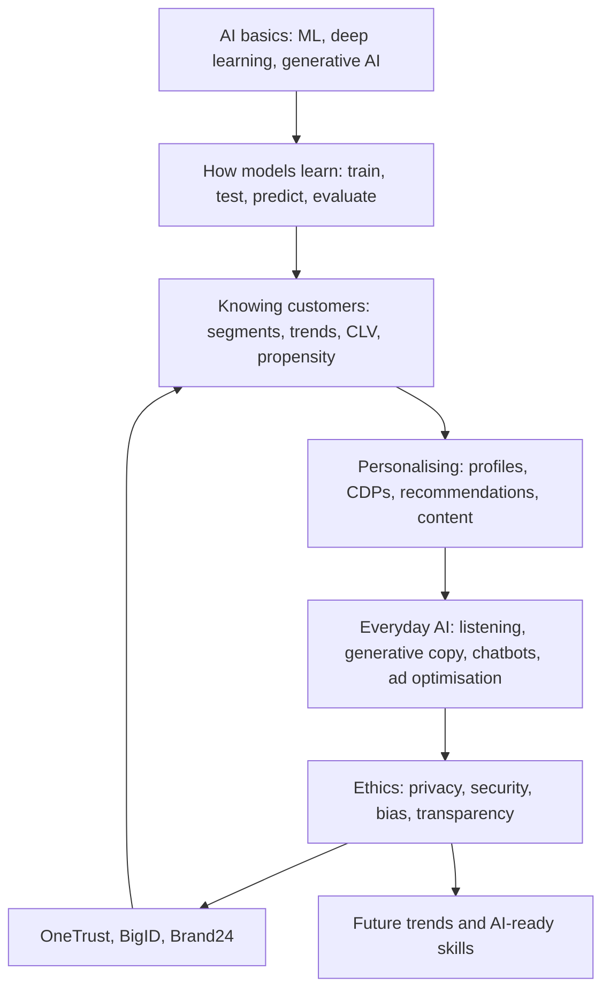

# Module 9 · Smart Digital Marketing with AI

> 🏠 [Diploma in Digital Marketing](../../README.md) › [Term 1](../README.md) › **Module 9**

[⬅ Previous module](../08-analytics/README.md) · [Start Session 1 ➡](session-01-introduction-to-ai-in-marketing.md) · [Next module ➡](../../capstone/README.md)

---

Artificial intelligence is now built into almost every marketing tool, from ad platforms to email and customer service. This module explains what AI is and how its algorithms learn, how AI finds and understands customers (segmentation, trends, CLV), how it personalises content and recommendations, how it powers everyday work (social listening, generative copy, chatbots, ad optimisation), and finally the ethics, privacy tools, reputation monitoring and future trends every AI-ready marketer must know. Every session includes runnable Python examples with real output.

## 🎯 Module objectives

- Define **AI, machine learning, deep learning and generative AI**, and build and evaluate a simple **predictive model** of customer behaviour.
- Use AI to **analyse customer trends**, segment customers, predict CLV and plan next-best actions with tools such as Salesforce Einstein, Adobe Sensei and Marketo.
- Explain how **customer profiles, CDPs and recommendation engines** personalise marketing, and plan content with AI SEO tools.
- Apply AI in daily work: **social listening and sentiment**, **generative AI copy**, **chatbots** and **AI-optimised advertising**.
- Explain the **ethical challenges** of AI marketing, use privacy tools such as **OneTrust** and **BigID**, monitor reputation with **Brand24**, and prepare for **future trends and careers**.

## 📅 Sessions

| # | Session | Prerequisites |
|---|---|---|
| 1 | [Introduction to AI in Marketing](session-01-introduction-to-ai-in-marketing.md) | Module 8 |
| 2 | [Finding and Knowing Your Customers with AI](session-02-knowing-customers-with-ai.md) | Session 1 |
| 3 | [Personalizing Marketing with AI](session-03-personalizing-marketing-with-ai.md) | Session 2 |
| 4 | [AI in Everyday Marketing Activities](session-04-ai-in-marketing-activities.md) | Session 3 |
| 5 | [Ethical AI and Future Trends](session-05-ethical-ai-and-future-trends.md) | Sessions 1-4 |
|  | 📝 [Module practice test](practice-test.md) | All sessions |

## 🧭 Concept map

## 💻 Code and charts in this module

All examples are runnable. See **[code/README.md](code/README.md)** for every file and how to run it. Python 3.10+ with `pip install pandas numpy matplotlib`.

| Session | Code | Chart |
|---|---|---|
| 1 | Purchase-prediction model; rules versus learning | Cumulative gains chart |
| 2 | k-means customer segments; seasonal trend forecast | Segment scatter; forecast line |
| 3 | Identity stitching into profiles; item-to-item recommender; content score | Similarity heat-map |
| 4 | Lexicon sentiment with topics; FAQ chatbot with handover; Thompson-sampling ad optimiser | Sentiment by topic; bandit traffic share |
| 5 | Personal-data scanner and masking; bias audit with four-fifths rule; brand monitor with alerts | Selection rate before/after; mentions and sentiment |

## 📄 One-page cheat-sheet

| Topic | Remember this |
|---|---|
| AI family | AI ⊃ machine learning ⊃ deep learning; generative AI creates new content |
| Learning types | Supervised (labelled: predict churn) · unsupervised (segments) · reinforcement (bidding, bandits) |
| ML loop | Data → features → train → test → predict → act → monitor |
| Model quality | Accuracy can mislead · precision (how many flagged are right) · recall (how many real ones found) · lift |
| Platforms | Vertex AI · HubSpot AI · RapidMiner · Salesforce Einstein · Adobe Sensei · Marketo |
| Knowing customers | Segmentation (k-means, RFM) · propensity · CLV · trend and seasonality · next-best-action |
| Personalisation levels | Mass → segment → individual → real-time 1:1 |
| CDP | Collect · stitch identities · unified profile · activate (Segment, Marketo) |
| Recommendations | Collaborative filtering (people/items alike) · content-based (attributes) · hybrid |
| Social listening | Volume · sentiment · topics · influencers · alerts – test on Roman Urdu |
| Generative AI prompt | RCTFC: Role · Context · Task · Format · Constraints – always fact-check |
| Chatbots | Intent · entity · fallback/handover · containment rate · CSAT |
| AI ad tools | Adzooma health check · automation rules · bandits shift traffic to winners |
| Ethics (FATPAS) | Fairness · Accountability · Transparency · Privacy · Accuracy · Security |
| Privacy tools | BigID finds and classifies personal data · OneTrust manages consent and compliance |
| Reputation | Brand24: mentions, sentiment, share of voice, spike alerts → honest crisis playbook |
| Trends | Generative AI · AI agents · AI search · hyper-personalisation · privacy-first measurement · conversational commerce · AI governance |

| Formula | Calculation |
|---|---|
| Precision / recall | TP ÷ (TP + FP) · TP ÷ (TP + FN) |
| Lift | Response rate in targeted group ÷ overall response rate |
| CLV (simple) | AOV × Frequency × Lifespan × Margin |
| Personalisation lift | (Personalised rate − Control rate) ÷ Control rate × 100 |
| Containment rate | Chats solved by bot ÷ Total chats × 100 |
| Break-even containment | Bot cost ÷ (Chats × Cost per human chat) |
| Net sentiment | % positive − % negative |
| Share of voice | Our mentions ÷ All brands' mentions × 100 |
| Disparate-impact ratio | Lower group selection rate ÷ Higher group selection rate (flag if < 0.80) |

**Common mistakes:** trusting accuracy alone · models trained on biased history · no holdout to prove lift · personalisation that feels creepy · publishing AI copy unchecked · bots with no human escape · applying every AI "opportunity" blindly · alerts on volume only · collecting data "just in case" · hiding AI involvement · ignoring Roman Urdu and local context.

---

Prepared by **Hamna Zahid Khan**, Junior Lecturer · Diploma in Digital Marketing
