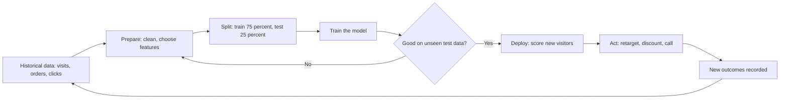
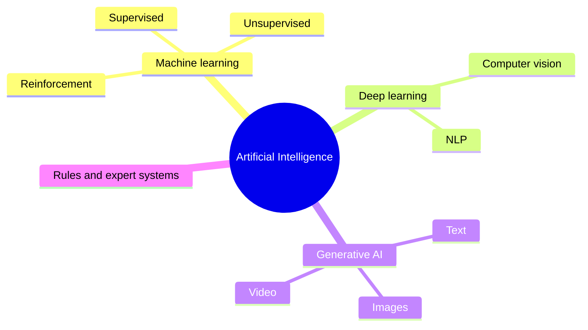
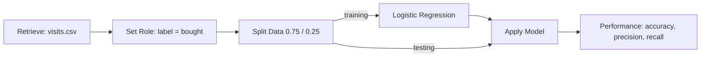
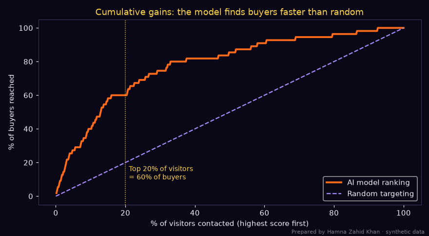
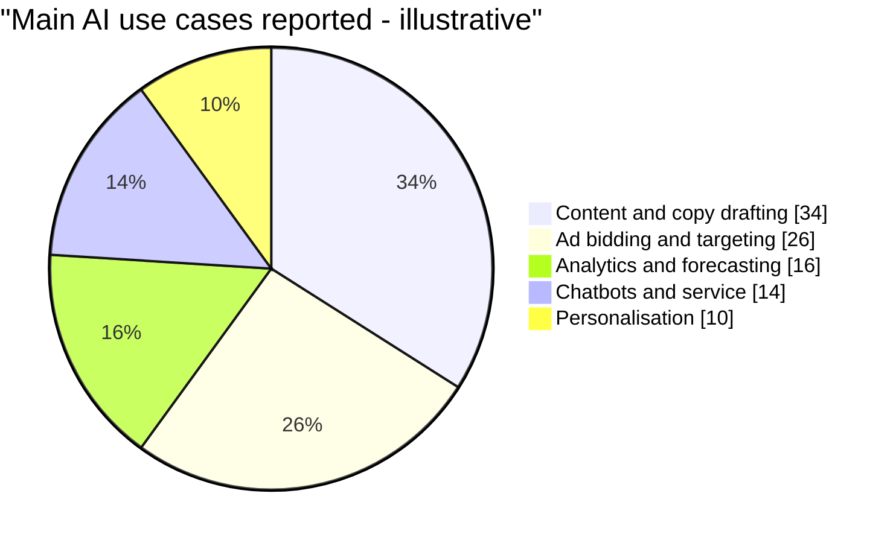

# Session 1 · Introduction to AI in Marketing

> 🏠 [Diploma in Digital Marketing](../../README.md) › [Term 1](../README.md) › [Smart Digital Marketing with AI](README.md) › **Session 1**
>
> ⏱ **Estimated time:** 3 hours (1.5 h theory + 1.5 h lab) · 📋 **Prerequisites:** Module 8

[⬅ Previous: Smart Digital Marketing with AI overview](README.md) · [Next: Session 2 ➡](session-02-knowing-customers-with-ai.md)

---

## 🎯 Learning objectives

By the end of this session you will be able to:

- Define **artificial intelligence (AI)**, machine learning, deep learning and generative AI, and explain why AI matters in marketing.
- Explain how **AI algorithms** learn from data (training, testing, prediction) and where each learning type fits in marketing.
- Illustrate how platforms such as **Google Cloud Vertex AI** (the successor to Google AI Platform) and **HubSpot AI** support marketing teams.
- Build a simple **predictive model of customer behaviour**, first as a visual workflow (the RapidMiner way) and then in Python.
- Summarise everyday AI techniques and match them to real marketing scenarios.

## 📖 Concepts

### 1. What is AI, and why do marketers care?

**Artificial intelligence** is the ability of software to perform tasks that normally need human judgement: recognising patterns, making predictions, understanding language, or creating content. In marketing, AI is less about robots and more about **making thousands of small decisions faster and better than a person could** – which ad to show, which customer is about to leave, which subject line to send, which product to recommend.

> 💡 **Analogy:** a good shopkeeper in Saddar remembers regular customers, notices what sells before Eid, and greets each person differently. AI lets an online brand do the same for two million customers at once.

| Term | Plain meaning | Marketing example |
|---|---|---|
| **Artificial intelligence (AI)** | Umbrella term for machines doing "smart" tasks | Any of the examples below |
| **Machine learning (ML)** | Algorithms that **learn patterns from data** instead of following hand-written rules | Predicting which leads will convert |
| **Deep learning** | ML using many-layered **neural networks**; good with images, audio, text | Recognising your product in Instagram photos |
| **Natural language processing (NLP)** | Understanding and generating human language | Sentiment of tweets, chatbots in Roman Urdu |
| **Generative AI** | Models that **create** new text, images, audio or video | Drafting ad copy, product photos, video scripts |
| **Predictive analytics** | Using data to estimate future outcomes | Next month's sales, churn risk, CLV |

**Why it matters now:** data volumes are huge (every click, scroll and WhatsApp message), computing is cheap in the cloud, and ad platforms (Google, Meta, TikTok) already run on AI. Marketers who understand it set better goals, feed better data and catch mistakes; those who don't simply press "auto" and hope.

### 2. How AI algorithms work

Every ML project follows the same basic loop:

1. **Data** – examples from the past, each with **features** (inputs such as pages viewed, city, device) and often a **label** (the answer, such as "bought" or "didn't buy").
2. **Training** – the algorithm adjusts internal numbers (**parameters/weights**) until its guesses match the labels as closely as possible.
3. **Testing** – we check it on data it has **never seen** to make sure it learned real patterns and not just memorised (**overfitting**).
4. **Prediction (inference)** – the trained model scores new customers in real time.
5. **Feedback** – new outcomes flow back in and the model is retrained.

| Learning type | How it learns | Marketing uses |
|---|---|---|
| **Supervised** | From labelled examples | Purchase prediction, lead scoring, churn, spam detection |
| **Unsupervised** | Finds structure without labels | Customer segmentation (clustering), anomaly detection |
| **Reinforcement** | Tries actions, gets rewards, improves | Automated bidding, choosing the best ad variant |
| **Generative** | Learns patterns of content to produce new content | Copywriting, image generation, chat assistants |

**Key algorithms you will meet** (no maths needed yet):

| Algorithm | Idea in one line | Output |
|---|---|---|
| Linear / logistic regression | Weighted sum of features | A number / a probability |
| Decision tree | A flowchart of yes/no questions learned from data | A class with readable rules |
| Random forest, gradient boosting | Many trees voting | More accurate predictions |
| k-means clustering | Group similar customers together | Segments |
| Collaborative filtering | "People like you also liked…" | Recommendations |
| Neural networks / transformers | Layers of simple units; the basis of large language models | Text, images, complex predictions |

### 3. Measuring a model honestly

A model that says "nobody will buy" is 89% accurate when only 11% of visitors buy – and completely useless. So marketers look beyond **accuracy**:

| Metric | Question it answers | Formula |
|---|---|---|
| **Accuracy** | How often is it right overall? | (TP + TN) ÷ All |
| **Precision** | Of the people we targeted, how many bought? | TP ÷ (TP + FP) |
| **Recall** | Of all the buyers, how many did we find? | TP ÷ (TP + FN) |
| **Lift** | How much better than random is our top group? | Conversion rate of top group ÷ overall rate |

TP = true positive (predicted buy, did buy), FP = false positive, FN = false negative, TN = true negative.

### 4. AI platforms for marketers

| Platform | What it gives a marketing team | Typical use |
|---|---|---|
| **Google Cloud Vertex AI** (formerly AI Platform) | Train, deploy and monitor ML models; AutoML for tabular data without coding; access to Gemini models | Custom propensity or CLV model on BigQuery data |
| **Google Ads / GA4 built-in AI** | Smart Bidding, Performance Max, predictive audiences ("likely 7-day purchasers") | Bid and audience optimisation |
| **HubSpot AI (Breeze)** | Predictive lead scoring, AI content assistant, chatbot builder, email send-time help | CRM-driven B2B and education marketing |
| **RapidMiner (Altair AI Studio)** | Drag-and-drop ML workflows: retrieve → prepare → model → evaluate | Learning ML visually; quick prototypes |
| **Meta Advantage+** | Automated audiences, placements and creative combinations | Social ad delivery |

> ⚠️ Tool names change often (AI Platform became Vertex AI; RapidMiner is now part of Altair). Learn the **capability**, not just the brand.

### 5. Simple AI techniques in real marketing

| Technique | Scenario (Pakistan) | Benefit |
|---|---|---|
| Propensity scoring | A Lahore fashion e-store scores visitors' chance to buy and retargets only the top 20% | Lower ad waste |
| Lead scoring | A Karachi private university ranks admission enquiries by likelihood to enrol | Counsellors call the best leads first |
| Churn prediction | A telecom flags prepaid users whose recharges are slowing | Timely bundle offers |
| Recommendation | A bookshop app suggests past papers to exam-guide buyers | Higher basket size |
| Dynamic pricing | Ride-hailing fares rise in rain or peak hours | Balances supply and demand |
| Smart bidding | Google Ads raises bids for searchers most likely to convert | Better CPA |
| Content generation | A restaurant drafts 20 Ramadan captions in Urdu and English, then edits the best | Saves hours |

## 🧭 Diagrams

### The machine-learning loop in marketing



### The AI family



### A RapidMiner-style visual workflow



## 💻 Worked examples

### Example 1 – Building a purchase-prediction model (the RapidMiner steps in Python)

**Walkthrough in a visual tool (RapidMiner / Altair AI Studio):**

1. **Retrieve** – drag your CSV (one row per visit) into the canvas.
2. **Set Role** – mark `bought` as the *label*; the other columns become features.
3. **Split Data** – 75% training, 25% testing, stratified so both parts have the same share of buyers.
4. **Logistic Regression** – connect the training output to the learner.
5. **Apply Model** – connect the trained model and the test set.
6. **Performance (Binominal Classification)** – read accuracy, precision, recall and the confusion matrix.

The Python file below does exactly those six boxes on 2,000 synthetic visits to a Lahore fashion store:

📄 `code/session-01_purchase_predictor.py`

```python
# A simple predictive model of customer behaviour: will a website visitor buy?
# The same steps a visual tool such as RapidMiner shows as boxes (retrieve -> split -> train -> apply -> evaluate),
# written in Python. Prepared by Hamna Zahid Khan, Junior Lecturer. Data is synthetic (an illustrative Lahore fashion store).
import numpy as np
import matplotlib
matplotlib.use("Agg")
import matplotlib.pyplot as plt
from sklearn.linear_model import LogisticRegression
from sklearn.model_selection import train_test_split
from sklearn.metrics import accuracy_score, confusion_matrix, precision_score, recall_score

BG, FIRE, GOLD, VIOLET, EMBER, TEXT = "#0A0716", "#FF6B1A", "#FCD34D", "#A78BFA", "#F43F5E", "#F5EEFF"
rng = np.random.default_rng(7)
N = 2000
# 1. Retrieve: one row per visit
pages = rng.poisson(4, N) + 1
minutes = np.round(rng.gamma(2, 2.2, N), 1)
returning = rng.binomial(1, 0.35, N)
from_ad = rng.binomial(1, 0.4, N)
cart_add = rng.binomial(1, np.clip(0.08 + 0.04 * pages, 0, 0.9))
logit = -5.2 + 0.18 * pages + 0.12 * minutes + 0.9 * returning + 0.3 * from_ad + 2.1 * cart_add
bought = rng.binomial(1, 1 / (1 + np.exp(-logit)))
X = np.column_stack([pages, minutes, returning, from_ad, cart_add])
names = ["pages_viewed", "minutes_on_site", "returning_visitor", "came_from_ad", "added_to_cart"]
print(f"Visits: {N}  purchases: {bought.sum()}  base conversion rate: {bought.mean():.1%}")

# 2. Split: learn on 75%, test on 25% the model has never seen
Xtr, Xte, ytr, yte = train_test_split(X, bought, test_size=0.25, random_state=1, stratify=bought)
# 3. Train
model = LogisticRegression(max_iter=1000).fit(Xtr, ytr)
# 4. Apply
prob = model.predict_proba(Xte)[:, 1]
pred = (prob >= 0.5).astype(int)
# 5. Evaluate
tn, fp, fn, tp = confusion_matrix(yte, pred).ravel()
print(f"\nTest set: {len(yte)} visits")
print(f"Accuracy  {accuracy_score(yte, pred):.1%}   (always guessing 'no' would score {1 - yte.mean():.1%})")
print(f"Precision {precision_score(yte, pred):.1%}   Recall {recall_score(yte, pred):.1%}")
print(f"Confusion matrix: TP={tp} FP={fp} FN={fn} TN={tn}")
# A lower threshold catches more buyers at the cost of more false alarms
pred20 = (prob >= 0.2).astype(int)
print(f"At threshold 0.20 -> precision {precision_score(yte, pred20):.1%}, recall {recall_score(yte, pred20):.1%}")
print("\nWhat the model learned (odds multiplier per +1 unit):")
for n, c in sorted(zip(names, model.coef_[0]), key=lambda t: -t[1]):
    print(f"  {n:<18} x{np.exp(c):.2f}")

# Marketing use: rank visitors by probability and target the top 20% with a retargeting offer
order = np.argsort(-prob)
top = order[: len(order) // 5]
lift = yte[top].mean() / yte.mean()
print(f"\nTop 20% scored visitors convert at {yte[top].mean():.1%} vs {yte.mean():.1%} overall -> lift {lift:.1f}x")
new_visitor = np.array([[6, 9.5, 1, 1, 1]])
print(f"New visitor (6 pages, 9.5 min, returning, from ad, added to cart): P(buy) = {model.predict_proba(new_visitor)[0, 1]:.0%}")

# Chart: cumulative gains (how many buyers we reach by contacting the top-scored visitors first)
cum = np.cumsum(yte[order]) / yte.sum()
x = np.arange(1, len(order) + 1) / len(order)
fig, ax = plt.subplots(figsize=(8, 4.4), facecolor=BG); ax.set_facecolor(BG)
ax.plot(x * 100, cum * 100, color=FIRE, lw=2.5, label="AI model ranking")
ax.plot([0, 100], [0, 100], color=VIOLET, ls="--", label="Random targeting")
ax.axvline(20, color=GOLD, lw=1, ls=":")
ax.text(21, 10, f"Top 20% of visitors\n= {cum[len(order)//5 - 1]:.0%} of buyers", color=GOLD, fontsize=9)
ax.set_xlabel("% of visitors contacted (highest score first)", color=TEXT)
ax.set_ylabel("% of buyers reached", color=TEXT)
ax.set_title("Cumulative gains: the model finds buyers faster than random", color=GOLD)
ax.tick_params(colors=TEXT)
for sp in ax.spines.values(): sp.set_color("#3b3355")
ax.legend(facecolor=BG, labelcolor=TEXT)
fig.text(0.99, 0.01, "Prepared by Hamna Zahid Khan · synthetic data", color=TEXT, alpha=0.5, ha="right", fontsize=7)
plt.tight_layout(); plt.savefig("session-01_gains_chart.png", dpi=110, facecolor=BG)
print("Saved session-01_gains_chart.png")
```

**Output**

```text
Visits: 2000  purchases: 219  base conversion rate: 10.9%

Test set: 500 visits
Accuracy  89.6%   (always guessing 'no' would score 89.0%)
Precision 80.0%   Recall 7.3%
Confusion matrix: TP=4 FP=1 FN=51 TN=444
At threshold 0.20 -> precision 34.7%, recall 60.0%

What the model learned (odds multiplier per +1 unit):
  added_to_cart      x6.77
  returning_visitor  x1.79
  pages_viewed       x1.22
  minutes_on_site    x1.13
  came_from_ad       x0.95

Top 20% scored visitors convert at 33.0% vs 11.0% overall -> lift 3.0x
New visitor (6 pages, 9.5 min, returning, from ad, added to cart): P(buy) = 48%
Saved session-01_gains_chart.png
```



**Reading the output:**

- **Accuracy 89.6%** looks great, but guessing "no one buys" scores 89.0%. This is the **accuracy paradox** – always check against the baseline.
- At the default 0.5 threshold, recall is only 7% (it finds very few buyers). Lowering the threshold to **0.20** finds **60% of buyers** with 35% precision – much more useful for a cheap retargeting ad.
- **Adding to cart** multiplies the odds of buying by about 6.8 and **returning visitors** by 1.8; coming from an ad barely matters here. That tells the team where to focus: cart recovery and loyalty.
- The **top 20%** of scored visitors convert at **3×** the average rate – that is the **lift** you sell to your manager.

### Example 2 – Rules versus learning

A marketer's rule of thumb ("people who open 5+ emails will re-order") versus a decision tree that learns its own rules from 900 subscribers of a Karachi bakery:

📄 `code/session-01_ai_vs_rules.py`

```python
# Rules versus learning: a hand-written rule compared with a decision tree that learns its own rules.
# Prepared by Hamna Zahid Khan, Junior Lecturer. Synthetic email-subscriber data for an illustrative Karachi bakery.
import numpy as np
from sklearn.tree import DecisionTreeClassifier, export_text

rng = np.random.default_rng(3)
N = 1200
opens_30d = rng.poisson(3, N)
days_since_order = rng.integers(1, 120, N)
orders_total = rng.poisson(2, N)
# hidden truth: people re-order when they open emails AND ordered recently, or are loyal
p = 0.04 + 0.12 * (opens_30d >= 4) + 0.55 * (days_since_order < 25) * (orders_total >= 2) + 0.25 * (orders_total >= 5)
reorder = rng.binomial(1, np.clip(p, 0, 0.95))

# A marketer's rule of thumb
rule = (opens_30d >= 5).astype(int)
print(f"Hand-written rule 'opens >= 5' accuracy: {(rule == reorder).mean():.1%}")

X = np.column_stack([opens_30d, days_since_order, orders_total])
tr, te = slice(0, 900), slice(900, N)
tree = DecisionTreeClassifier(max_depth=3, random_state=0).fit(X[tr], reorder[tr])
print(f"Learned decision tree accuracy on unseen data: {(tree.predict(X[te]) == reorder[te]).mean():.1%}")
print("\nRules the tree learned by itself:")
print(export_text(tree, feature_names=["opens_30d", "days_since_order", "orders_total"], decimals=0))
```

**Output**

```text
Hand-written rule 'opens >= 5' accuracy: 72.7%
Learned decision tree accuracy on unseen data: 86.3%

Rules the tree learned by itself:
|--- days_since_order <= 26
|   |--- orders_total <= 2
|   |   |--- opens_30d <= 8
|   |   |   |--- class: 0
|   |   |--- opens_30d >  8
|   |   |   |--- class: 0
|   |--- orders_total >  2
|   |   |--- orders_total <= 4
|   |   |   |--- class: 1
|   |   |--- orders_total >  4
|   |   |   |--- class: 1
|--- days_since_order >  26
|   |--- orders_total <= 4
|   |   |--- opens_30d <= 4
|   |   |   |--- class: 0
|   |   |--- opens_30d >  4
|   |   |   |--- class: 0
|   |--- orders_total >  4
|   |   |--- days_since_order <= 40
|   |   |   |--- class: 0
|   |   |--- days_since_order >  40
|   |   |   |--- class: 0
```

The tree discovers what the rule missed: **recent buyers with at least two past orders** re-order, even if they open few emails. Its rules are still human-readable, which makes trees good for explaining AI to non-technical managers.

### Example 3 – Calculating precision, recall and lift by hand

An admissions team uses a lead-scoring model on 1,000 enquiries; 100 actually enrol. They call the 150 highest-scored leads, and 60 of those enrol.

| Measure | Working | Result |
|---|---|---|
| Precision | 60 ÷ 150 | **40%** |
| Recall | 60 ÷ 100 | **60%** |
| Overall enrolment rate | 100 ÷ 1,000 | 10% |
| Lift of called group | 40% ÷ 10% | **4×** |
| Calls saved vs calling everyone | 1,000 − 150 | 850 calls |

If a counsellor call costs PKR 120, calling everyone costs PKR 120,000 for 100 enrolments (PKR 1,200 each); calling the top 150 costs **PKR 18,000 for 60 enrolments (PKR 300 each)**.

### Example 4 – HubSpot AI walkthrough (predictive lead scoring)

1. In HubSpot, open **Contacts → Lead scoring** and choose an AI/predictive score (available on higher tiers).
2. HubSpot trains on your past contacts that became customers (needs a few hundred closed deals).
3. Each contact gets a **likelihood to close** and a **priority** (very high → low).
4. Build a list "Priority = very high AND no activity in 3 days" and auto-assign to a counsellor.
5. Review monthly: are very-high leads really closing more often? If not, check data quality (lifecycle stages, missing deal records).

## 📊 Chart · Where AI is used most in marketing teams (illustrative survey of 50 Pakistani agencies)



## 📋 Checklist · Is this problem right for AI?

| Question | Yes means… |
|---|---|
| Is the decision repeated often (daily, per customer, per impression)? | Automation pays off |
| Do we have enough historical examples with outcomes (hundreds to thousands)? | A model can learn |
| Can we measure success clearly (sale, click, enrolment)? | We can evaluate and improve |
| Is a wrong prediction low-risk, or can a human review it? | Safe to deploy |
| Will the prediction change an action (call, offer, bid)? | It creates value |
| Do we have consent to use the data this way? | Ethically and legally sound |

## ⚠️ Common mistakes

| Mistake | Why it hurts | Fix |
|---|---|---|
| Trusting accuracy alone | Misses the accuracy paradox on rare events | Compare with baseline; use precision, recall, lift |
| Testing on training data | Overfitting looks like genius | Always keep an unseen test set |
| "Garbage in, garbage out" | Duplicates and wrong labels teach wrong patterns | Clean and validate data first |
| Treating AI as magic | No clear goal, no measurement | Start with a business question and KPI |
| Using AI copy unedited | Errors, wrong tone, generic text | Human review and brand voice guide |
| Forgetting data leakage | A feature that reveals the answer (e.g. "delivery date") | Only use data available **before** the decision |

## ✅ Best practices

- Start small: one use case, one KPI, a baseline, then expand.
- Keep a human in the loop for high-impact decisions (pricing, credit, sensitive audiences).
- Document data sources, features and model versions.
- Re-train regularly – customer behaviour shifts around Ramadan, Eid, budget announcements and sales seasons.
- Explain models with readable rules or feature importance before asking managers to trust them.

## 🧪 Lab / practice tasks

**Task 1 (easy) – Match the technique.** Match each need to supervised, unsupervised, reinforcement or generative learning: (a) group app users into personas, (b) predict who will cancel a subscription, (c) write 10 headline variants, (d) adjust bids every hour based on results.

<details><summary>✅ Solution</summary>

(a) Unsupervised (clustering) · (b) Supervised (classification) · (c) Generative · (d) Reinforcement (learning from rewards).

</details>

**Task 2 (easy) – Metrics by hand.** A churn model flags 200 customers; 80 really churn. In total 160 customers churned. Calculate precision and recall.

<details><summary>✅ Solution</summary>

Precision = 80 ÷ 200 = **40%**. Recall = 80 ÷ 160 = **50%**.

</details>

**Task 3 (medium) – Threshold experiment.** In `code/session-01_purchase_predictor.py`, print precision and recall for thresholds 0.1, 0.2, 0.3, 0.4 and 0.5. Which would you choose for (a) a free retargeting audience and (b) a PKR 1,000 discount voucher?

<details><summary>💡 Hint</summary>

Loop: `for t in [0.1, 0.2, 0.3, 0.4, 0.5]: p = (prob >= t).astype(int); print(t, precision_score(yte, p), recall_score(yte, p))`. Cheap actions tolerate low precision (choose a low threshold); expensive vouchers need high precision (choose a higher threshold).

</details>

**Task 4 (medium) – Visual workflow.** Install the free edition of RapidMiner/Altair AI Studio (or use any drag-and-drop ML tool) and rebuild Example 1 with the six operators. Screenshot the process and the performance tab. Do your numbers match Python's roughly?

**Task 5 (challenge) – AI opportunity memo.** Choose a real Pakistani business you know (pharmacy chain, school, clothing brand). Write a one-page memo: the business question, data needed, learning type, success metric, risks and a 30-day pilot plan. Use the checklist above.

## ✅ Quick quiz

1. Which learns from labelled examples?
   a) Unsupervised learning b) Supervised learning c) Clustering d) Generative design
2. A model that predicts "no purchase" for everyone on a store where 5% buy has accuracy of about:
   a) 5% b) 50% c) 95% d) 100%
3. Recall answers:
   a) Of those we targeted, how many converted? b) Of all converters, how many did we find? c) How fast is the model? d) What is the CPC?
4. Which Google Cloud service replaced AI Platform for training and deploying models?
   a) Looker Studio b) Vertex AI c) Search Console d) Tag Manager
5. Testing a model on data it has never seen protects against:
   a) high CPC b) overfitting c) low reach d) spam

<details><summary>Show answers</summary>

1-b · 2-c · 3-b · 4-b · 5-b

</details>

## 📝 Summary

- **AI** = software doing judgement tasks; **ML** learns from data; **deep learning** uses neural networks; **generative AI** creates content.
- The ML loop: **data → prepare → split → train → test → deploy → feedback**.
- Supervised (predict), unsupervised (segment), reinforcement (optimise actions), generative (create).
- Judge models by **precision, recall and lift**, not accuracy alone; compare with a baseline.
- Platforms: **Vertex AI**, built-in Google/Meta AI, **HubSpot AI**, visual tools like **RapidMiner**.
- Start with a clear business question, clean data, a KPI and a human in the loop.

**Interview / viva questions**

1. Explain the difference between AI, machine learning and generative AI with marketing examples.
2. What is overfitting and how do you detect it?
3. Why can a 95%-accurate model be useless?
4. Describe the steps to build a purchase-prediction model in a visual tool.
5. When would you choose a decision tree over a more accurate "black-box" model?
6. Give three AI use cases for a Pakistani e-commerce brand and the KPI for each.

---

[⬅ Previous: Smart Digital Marketing with AI overview](README.md) · [Next: Session 2 ➡](session-02-knowing-customers-with-ai.md)

<sub>Prepared by **Hamna Zahid Khan**, Junior Lecturer · Diploma in Digital Marketing</sub>
