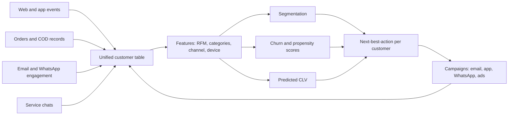
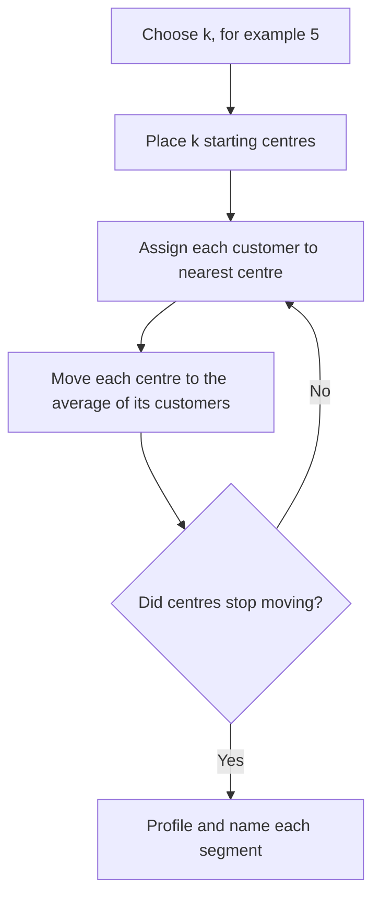
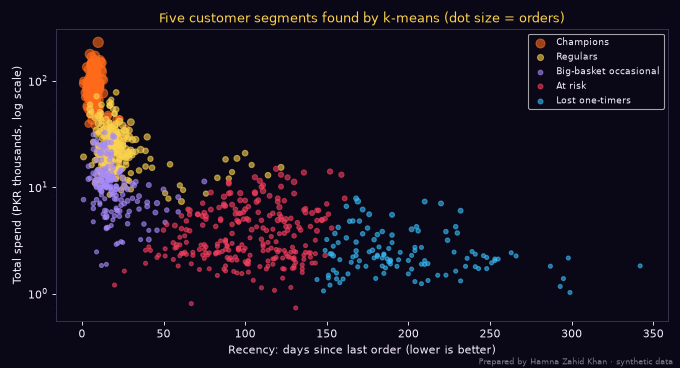
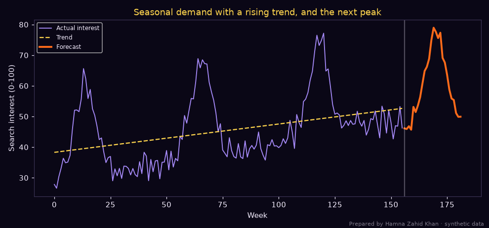
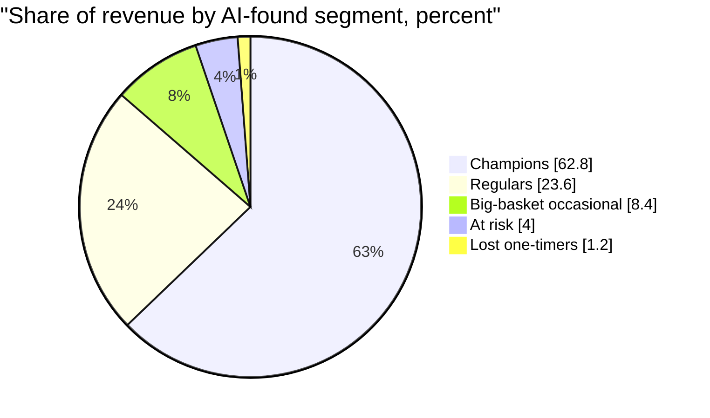

# Session 2 · Finding and Knowing Your Customers with AI

> 🏠 [Diploma in Digital Marketing](../../README.md) › [Term 1](../README.md) › [Smart Digital Marketing with AI](README.md) › **Session 2**
>
> ⏱ **Estimated time:** 3 hours (1.5 h theory + 1.5 h lab) · 📋 **Prerequisites:** Session 1

[⬅ Previous: Session 1](session-01-introduction-to-ai-in-marketing.md) · [Next: Session 3 ➡](session-03-personalizing-marketing-with-ai.md)

---

## 🎯 Learning objectives

By the end of this session you will be able to:

- Define how AI **analyses customer trends** and explain why this matters for planning campaigns.
- Explain AI techniques – **segmentation, propensity, CLV prediction, next-best-action** – that customise customer experiences from data.
- Illustrate how enterprise tools such as **Salesforce Einstein**, **Adobe Sensei** and **Marketo** apply AI to marketing.
- Walk through a **Tableau + Einstein-style analysis** of customer data and turn it into actionable insights.
- Summarise how AI **predicts customer needs** and drives personalised marketing strategies.

## 📖 Concepts

### 1. From "who bought" to "who will buy, what, and when"

Traditional reports describe the past. AI-driven customer analysis looks for **patterns humans would miss** and projects them forward:

| Question | Traditional answer | AI-driven answer |
|---|---|---|
| Who are our customers? | Age, city, gender from forms | Behavioural **segments** discovered from purchases, browsing and engagement |
| What is trending? | Last month's best-sellers | **Trend and seasonality detection** across searches, social and sales, with forecasts |
| Who will leave? | We notice after they've gone | **Churn propensity** scores weeks in advance |
| Who is most valuable? | Top spenders last year | **Predicted CLV** over the next 12 months |
| What should we offer? | Same offer to everyone | **Next-best-action**: the offer most likely to work for each person |

### 2. Where the data comes from

| Source | Examples | Notes |
|---|---|---|
| **First-party behavioural** | Website/app events, orders, cart adds, email opens | Most valuable and privacy-safe if consented |
| **Zero-party** | Quiz answers, preference centre, surveys | Customers tell you directly |
| **Transactional** | POS, Shopify, Daraz seller centre, COD records | Revenue truth |
| **Service** | WhatsApp chats, call logs, complaints | Reveals pain points; needs NLP |
| **Market and social** | Google Trends, social listening, competitor prices | Context for trends |

### 3. Core AI techniques for knowing customers

| Technique | How it works | Output | Action |
|---|---|---|---|
| **RFM + clustering** | Recency, Frequency, Monetary value fed to **k-means** | Segments such as Champions, At risk | Tailored offers per segment |
| **Propensity models** | Supervised model predicts the probability of an action | Score 0–1 per customer | Target top scorers |
| **Churn prediction** | Model trained on customers who left vs stayed | Risk score and reasons | Win-back before they leave |
| **Predicted CLV** | Models future purchases and value | PKR value per customer | Set acquisition budgets, VIP care |
| **Trend forecasting** | Separates **trend**, **seasonality** and noise | Forecast with peaks | Plan stock, creatives, budget |
| **Next-best-action** | Scores many possible offers per customer | Ranked offers | Personalised email/app/WhatsApp |
| **Anomaly detection** | Flags unusual spikes or drops | Alerts | Investigate fraud, outages, viral posts |

**RFM in one minute:** **Recency** = days since last purchase (lower is better), **Frequency** = number of orders, **Monetary** = total spend. A customer who bought 3 days ago, 15 times, for PKR 90,000 is a Champion; one who bought once, 200 days ago, is probably lost.

**How k-means works:** pick *k* centre points, assign every customer to the nearest centre, move each centre to the average of its customers, repeat until stable. Use the **elbow method** (plot *inertia* for k = 2…8 and look for where improvement flattens) plus business sense to choose *k*.

### 4. Enterprise AI tools

| Tool | Part of | What its AI does for customer insight |
|---|---|---|
| **Salesforce Einstein** | Salesforce CRM/Marketing Cloud | Lead and opportunity scoring, engagement scoring (likelihood to open/click/unsubscribe), send-time optimisation, Einstein Discovery for "why" analysis, generative email drafts |
| **Adobe Sensei** | Adobe Experience Cloud (Analytics, Target, Real-Time CDP) | Anomaly detection and contribution analysis in Adobe Analytics, auto-targeting personalisation, intelligent image tagging and cropping, segment discovery |
| **Marketo Engage** (Adobe) | Marketing automation | Predictive audiences and content, behavioural lead scoring, account-based insights for B2B |
| **Tableau + Einstein / Tableau Pulse** | Tableau (Salesforce) | Visual analysis with AI-generated explanations, predictions and natural-language insights |

> These tools are expensive and used by large brands (banks, telecoms, multinationals in Pakistan). Smaller businesses get similar ideas from GA4 predictive audiences, HubSpot, Klaviyo or a Python notebook – which is exactly what we do in the examples.

### 5. From prediction to personalised strategy

1. **Predict** the need (score, segment, forecast).
2. **Decide** the action per segment (offer, message, channel, timing).
3. **Personalise** the experience (content, product, price band).
4. **Measure** against a control group.
5. **Learn** and update the model.

## 🧭 Diagrams

### Customer intelligence pipeline



### How k-means finds segments



## 💻 Worked examples

### Example 1 – Finding segments in 1,000 grocery customers

An Islamabad/Rawalpindi online grocery store wants to stop sending the same "10% off" to everyone. We compute RFM, scale it, check the elbow, run k-means with k = 5, profile each cluster and attach an action:

📄 `code/session-02_customer_segments.py`

```python
# Finding customer segments with AI: RFM features + k-means clustering, then naming each segment
# and choosing an action. Prepared by Hamna Zahid Khan, Junior Lecturer.
# Synthetic orders for an illustrative online grocery store in Islamabad/Rawalpindi.
import numpy as np
import pandas as pd
import matplotlib
matplotlib.use("Agg")
import matplotlib.pyplot as plt
from sklearn.cluster import KMeans
from sklearn.preprocessing import StandardScaler

BG, FIRE, GOLD, VIOLET, EMBER, TEXT = "#0A0716", "#FF6B1A", "#FCD34D", "#A78BFA", "#F43F5E", "#F5EEFF"
rng = np.random.default_rng(11)
groups = [  # (count, recency mean days, orders mean, avg basket PKR)
    (180, 8, 14, 6500),    # loyal weekly shoppers
    (260, 20, 5, 3800),    # regular
    (140, 15, 2, 11000),   # big-basket occasional
    (220, 95, 2, 2600),    # drifting away
    (200, 160, 1, 1900),   # one-time
]
rows = []
for g, (n, r, f, m) in enumerate(groups):
    for _ in range(n):
        orders = max(1, int(rng.poisson(f)))
        rows.append({"recency_days": int(np.clip(rng.normal(r, r * 0.35), 1, 365)),
                     "frequency": orders,
                     "monetary": round(orders * max(600, rng.normal(m, m * 0.25)))})
df = pd.DataFrame(rows)
print(f"Customers: {len(df)}  total revenue PKR {df.monetary.sum():,.0f}")

X = StandardScaler().fit_transform(np.column_stack([df.recency_days, np.log1p(df.frequency), np.log1p(df.monetary)]))
# Elbow check: inertia for k = 2..7
print("\nElbow check (lower inertia = tighter clusters):")
for k in range(2, 8):
    print(f"  k={k}  inertia={KMeans(n_clusters=k, n_init=10, random_state=0).fit(X).inertia_:7.1f}")

km = KMeans(n_clusters=5, n_init=10, random_state=0).fit(X)
df["cluster"] = km.labels_
prof = df.groupby("cluster").agg(customers=("frequency", "size"), recency=("recency_days", "median"),
                                 orders=("frequency", "median"), revenue=("monetary", "sum"))
prof["avg_value"] = (prof.revenue / prof.customers).round()
prof["rev_share"] = (prof.revenue / prof.revenue.sum() * 100).round(1)

def name(r):
    if r.recency <= 14 and r.orders >= 8: return "Champions"
    if r.recency > 120: return "Lost one-timers"
    if r.recency > 60: return "At risk"
    if r.orders >= 4: return "Regulars"
    return "Big-basket occasional"
ACTION = {"Champions": "VIP early access, referral reward, no discounts needed",
          "Regulars": "Subscription / repeat-basket reminder, cross-sell",
          "Big-basket occasional": "Bulk-buy bundles before month start (salary week)",
          "At risk": "Win-back WhatsApp with free delivery, ask for feedback",
          "Lost one-timers": "Low-cost email only; suppress from paid retargeting"}
prof["segment"] = prof.apply(name, axis=1)
prof = prof.sort_values("revenue", ascending=False)
print("\nSegment profile:")
print(prof[["segment", "customers", "recency", "orders", "avg_value", "rev_share"]].to_string())
print("\nNext best action per segment:")
for s in prof.segment:
    print(f"  {s:<22} -> {ACTION[s]}")

fig, ax = plt.subplots(figsize=(8.5, 4.6), facecolor=BG); ax.set_facecolor(BG)
cols = [FIRE, GOLD, VIOLET, EMBER, "#38BDF8"]
for (c, row), col in zip(prof.iterrows(), cols):
    d = df[df.cluster == c]
    ax.scatter(d.recency_days, d.monetary / 1000, s=10 + 3 * d.frequency, color=col, alpha=0.6, label=row.segment)
ax.set_yscale("log")
ax.set_xlabel("Recency: days since last order (lower is better)", color=TEXT)
ax.set_ylabel("Total spend (PKR thousands, log scale)", color=TEXT)
ax.set_title("Five customer segments found by k-means (dot size = orders)", color=GOLD)
ax.tick_params(colors=TEXT)
for sp in ax.spines.values(): sp.set_color("#3b3355")
ax.legend(facecolor=BG, labelcolor=TEXT, fontsize=8)
fig.text(0.99, 0.01, "Prepared by Hamna Zahid Khan · synthetic data", color=TEXT, alpha=0.5, ha="right", fontsize=7)
plt.tight_layout(); plt.savefig("session-02_segments.png", dpi=80, facecolor=BG)
print("Saved session-02_segments.png")
```

**Output**

```text
Customers: 1000  total revenue PKR 26,641,168

Elbow check (lower inertia = tighter clusters):
  k=2  inertia= 1236.7
  k=3  inertia=  702.8
  k=4  inertia=  515.6
  k=5  inertia=  385.2
  k=6  inertia=  300.0
  k=7  inertia=  262.4

Segment profile:
                       segment  customers  recency  orders  avg_value  rev_share
cluster                                                                         
1                    Champions        185      8.0    14.0    90452.0       62.8
3                     Regulars        249     19.0     5.0    25212.0       23.6
4        Big-basket occasional        188     16.0     2.0    11901.0        8.4
2                      At risk        260    102.0     1.0     4147.0        4.0
0              Lost one-timers        118    188.5     1.0     2662.0        1.2

Next best action per segment:
  Champions              -> VIP early access, referral reward, no discounts needed
  Regulars               -> Subscription / repeat-basket reminder, cross-sell
  Big-basket occasional  -> Bulk-buy bundles before month start (salary week)
  At risk                -> Win-back WhatsApp with free delivery, ask for feedback
  Lost one-timers        -> Low-cost email only; suppress from paid retargeting
Saved session-02_segments.png
```



**Insights for the marketing plan:**

- **Champions** are 18.5% of customers but **62.8% of revenue**. Protect them with service and early access – discounts would waste margin.
- The elbow flattens after k = 4–5, and five segments map to clear actions, so k = 5 is a sensible business choice.
- **At risk** (260 customers, last order ~100 days ago) is the biggest win-back opportunity: a free-delivery WhatsApp costs little compared with acquiring a new customer.
- **Lost one-timers** should be removed from paid retargeting audiences – a direct cost saving.

### Example 2 – Detecting a seasonal trend and forecasting the next peak

Three years of weekly search interest for "lawn suit" (synthetic data shaped like real Pakistani seasonality, peaking with spring lawn launches):

📄 `code/session-02_trend_forecast.py`

```python
# Spotting customer trends: decompose weekly search interest into trend + seasonality and forecast ahead.
# Prepared by Hamna Zahid Khan, Junior Lecturer. Synthetic weekly interest (0-100) for "lawn suit" in Pakistan.
import numpy as np
import matplotlib
matplotlib.use("Agg")
import matplotlib.pyplot as plt

BG, FIRE, GOLD, VIOLET, EMBER, TEXT = "#0A0716", "#FF6B1A", "#FCD34D", "#A78BFA", "#F43F5E", "#F5EEFF"
rng = np.random.default_rng(5)
weeks = np.arange(156)                      # three years of weekly data
season = 30 * np.exp(-((weeks % 52 - 14) ** 2) / 40)   # peak around week 14 (spring lawn launches)
trend = 30 + 0.12 * weeks
y = trend + season + rng.normal(0, 3, len(weeks))

# Fit trend with least squares on a straight line + average seasonal pattern by week-of-year
A = np.column_stack([np.ones_like(weeks), weeks])
coef, *_ = np.linalg.lstsq(A, y, rcond=None)
resid = y - A @ coef
seasonal = np.array([resid[weeks % 52 == w].mean() for w in range(52)])
fit = A @ coef + seasonal[weeks % 52]
mape = np.mean(np.abs((y - fit) / y)) * 100
print(f"Trend: +{coef[1]:.2f} interest points per week ({coef[1] * 52:.1f} per year)")
print(f"Seasonal peak week-of-year: {seasonal.argmax()} (+{seasonal.max():.1f} above trend)")
print(f"Seasonal low week-of-year:  {seasonal.argmin()} ({seasonal.min():.1f})")
print(f"In-sample error (MAPE): {mape:.1f}%")

future = np.arange(156, 182)
fc = coef[0] + coef[1] * future + seasonal[future % 52]
peak = future[fc.argmax()]
print(f"\nForecast next 26 weeks: peak at week {peak} (week-of-year {peak % 52}) with interest {fc.max():.0f}")
print(f"Plan: creatives ready by week-of-year {peak % 52 - 6}, budget ramp from week-of-year {peak % 52 - 3}")

fig, ax = plt.subplots(figsize=(9, 4.2), facecolor=BG); ax.set_facecolor(BG)
ax.plot(weeks, y, color=VIOLET, lw=1.2, label="Actual interest")
ax.plot(weeks, A @ coef, color=GOLD, ls="--", label="Trend")
ax.plot(future, fc, color=FIRE, lw=2.5, label="Forecast")
ax.axvline(156, color=TEXT, alpha=0.3)
ax.set_xlabel("Week", color=TEXT); ax.set_ylabel("Search interest (0-100)", color=TEXT)
ax.set_title("Seasonal demand with a rising trend, and the next peak", color=GOLD)
ax.tick_params(colors=TEXT)
for sp in ax.spines.values(): sp.set_color("#3b3355")
ax.legend(facecolor=BG, labelcolor=TEXT, fontsize=8)
fig.text(0.99, 0.01, "Prepared by Hamna Zahid Khan · synthetic data", color=TEXT, alpha=0.5, ha="right", fontsize=7)
plt.tight_layout(); plt.savefig("session-02_trend_forecast.png", dpi=110, facecolor=BG)
print("Saved session-02_trend_forecast.png")
```

**Output**

```text
Trend: +0.09 interest points per week (4.8 per year)
Seasonal peak week-of-year: 13 (+25.0 above trend)
Seasonal low week-of-year:  47 (-9.9)
In-sample error (MAPE): 5.4%

Forecast next 26 weeks: peak at week 169 (week-of-year 13) with interest 79
Plan: creatives ready by week-of-year 7, budget ramp from week-of-year 10
Saved session-02_trend_forecast.png
```



**Turning it into action:** the forecast peak is week-of-year 13 (late March), so creatives must be ready about six weeks before and budgets should ramp three weeks before. Interest is also rising about 5 points a year, so next season's budget should be higher than last season's.

### Example 3 – Predicted CLV and acquisition budget (hand calculation)

Segment "Regulars": average order PKR 5,000, 0.8 orders per month, expected lifespan 18 months, gross margin 22%.

| Step | Working | Result |
|---|---|---|
| Orders in lifetime | 0.8 × 18 | 14.4 |
| Revenue | 14.4 × 5,000 | PKR 72,000 |
| Predicted CLV (gross profit) | 72,000 × 0.22 | **PKR 15,840** |
| Max CAC at CLV:CAC = 3:1 | 15,840 ÷ 3 | **PKR 5,280** |

So the store can afford to spend up to about PKR 5,280 to acquire a customer who will become a Regular – far more than the PKR 1,000 first-order CPA it was fighting to hit.

### Example 4 – Tableau + Einstein-style lab walkthrough

The hands-on lab uses Tableau with Salesforce's AI features. If you don't have a licence, use **Tableau Public** (free) for the visual parts and the Python outputs above for the predictions.

1. **Connect** – open Tableau, connect to a CSV export of customers (`customer_id, recency_days, frequency, monetary, city, segment`). Save the Python segments with `df.to_csv("customers.csv")` if needed.
2. **Explore** – drag `segment` to Rows and `SUM(monetary)` to Columns; sort descending. Add `COUNT(customer_id)` as a label.
3. **Map** – drag `city` to the canvas to create a map; colour by average recency. Where are customers drifting?
4. **Ask "why"** – in Tableau with Einstein/Pulse, use **Explain Data** on the At-risk bar: it suggests which fields (city, category, delivery time) differ most. In Tableau Public, build the same comparison manually with a bar chart of average delivery days by segment.
5. **Predict** – in Einstein Discovery, create a story with outcome = `churned` (yes/no); review top predictors and recommended improvements.
6. **Act** – write three insight cards: *what we saw → why it matters → what we'll do*, e.g. "At-risk customers had 2 more days of delivery delay → delays drive churn → prioritise courier SLA in Rawalpindi and send apology vouchers".

## 📊 Chart · Revenue share by segment (from Example 1)



## 📋 Template · Segment action card

| Field | Example (At risk) | Your segment |
|---|---|---|
| Segment name and size | At risk – 260 customers | |
| Defining behaviour | Last order 60–150 days ago, 1–2 orders | |
| Value at stake | ~PKR 1.07 M historical revenue (4% of PKR 26.6 M) | |
| Likely need or pain | Delivery delays, found cheaper option | |
| Offer | Free delivery on next order this week | |
| Channel and timing | WhatsApp, Thursday evening | |
| Success metric | Reactivation rate vs 10% control group | |
| Owner and review date | CRM lead, in 30 days | |

## ⚠️ Common mistakes

| Mistake | Fix |
|---|---|
| Clustering on raw rupees and days together | **Scale** features first (StandardScaler) and log-transform skewed spend |
| Picking k only from the elbow | Combine the elbow with whether segments are actionable |
| Naming segments without checking profiles | Look at medians and revenue share before labelling |
| Forecasting with a straight line through seasonal data | Model trend **and** seasonality separately |
| Personalising without a control group | Keep 5–10% holdout to prove lift |
| Treating segments as permanent | Re-run monthly; customers move between segments |

## ✅ Best practices

- Combine behavioural data (what people do) with zero-party data (what they tell you).
- Keep a simple, explainable model first; upgrade only when it pays.
- Share segment definitions with sales, service and content teams so everyone uses the same language.
- Respect privacy: segment on behaviour and consented data, not sensitive traits.

## 🧪 Lab / practice tasks

**Task 1 (easy) – RFM by hand.** Classify: (a) 5 days, 12 orders, PKR 70,000; (b) 140 days, 1 order, PKR 1,500; (c) 75 days, 3 orders, PKR 9,000.

<details><summary>✅ Solution</summary>

(a) Champion · (b) Lost one-timer · (c) At risk.

</details>

**Task 2 (easy) – CLV.** AOV PKR 3,000, 1.5 orders/month, 12-month lifespan, 30% margin. What is CLV and the maximum CAC at 3:1?

<details><summary>✅ Solution</summary>

1.5 × 12 = 18 orders × 3,000 = PKR 54,000 × 0.30 = **PKR 16,200**; max CAC = **PKR 5,400**.

</details>

**Task 3 (medium) – Try k = 4.** Change `n_clusters=5` to 4 in `code/session-02_customer_segments.py`. Which two groups merge? Is the result more or less useful for marketing?

<details><summary>💡 Hint</summary>

Usually the two mid-value groups (Regulars and Big-basket occasional) merge. Fewer segments are easier to run but lose the "bulk-buy before salary week" opportunity. Note that the `name()` function may need adjusting.

</details>

**Task 4 (medium) – Your own trend.** Open Google Trends, set region = Pakistan, past 5 years, and search a seasonal term ("school bags", "air cooler", "mehndi design"). Note peak months and whether the trend is rising. Write a two-line campaign timing plan.

**Task 5 (challenge) – Insight deck.** Using Example 1's output and your Tableau Public charts, produce three insight cards and a one-slide segment strategy with offers, channels and KPIs.

## ✅ Quick quiz

1. In RFM, "R" stands for:
   a) Revenue b) Recency c) Reach d) Retention
2. Before running k-means on days and rupees you should:
   a) delete outliers only b) scale the features c) sort by date d) remove all small customers
3. Which tool family includes Sensei?
   a) Salesforce b) Adobe c) HubSpot d) Google
4. Predicted CLV helps marketers mainly to:
   a) choose fonts b) set how much they can spend to acquire and keep customers c) write captions d) avoid SEO
5. A forecast for a seasonal product should model:
   a) only the trend b) trend and seasonality c) only last week d) only competitor prices

<details><summary>Show answers</summary>

1-b · 2-b · 3-b · 4-b · 5-b

</details>

## 📝 Summary

- AI turns customer data into **segments, scores, forecasts and next-best-actions**.
- **RFM + k-means** finds behavioural segments; scale data and choose actionable *k*.
- **Trend + seasonality** decomposition times campaigns and budgets.
- **Predicted CLV** sets sensible acquisition budgets (CLV:CAC ≈ 3:1).
- Enterprise tools: **Salesforce Einstein**, **Adobe Sensei**, **Marketo**, **Tableau with Einstein**; small teams can do the same in Python, GA4 or HubSpot.
- Always prove personalisation with a **control group**.

**Interview / viva questions**

1. What is RFM analysis and how do you use it with clustering?
2. How do you choose the number of clusters in k-means?
3. Explain how Salesforce Einstein or Adobe Sensei helps a marketing team.
4. Calculate CLV for a given customer and explain how it guides budget.
5. How would you detect and plan for seasonality in demand?
6. Why must a personalisation programme keep a control group?

---

[⬅ Previous: Session 1](session-01-introduction-to-ai-in-marketing.md) · [Next: Session 3 ➡](session-03-personalizing-marketing-with-ai.md)

<sub>Prepared by **Hamna Zahid Khan**, Junior Lecturer · Diploma in Digital Marketing</sub>
