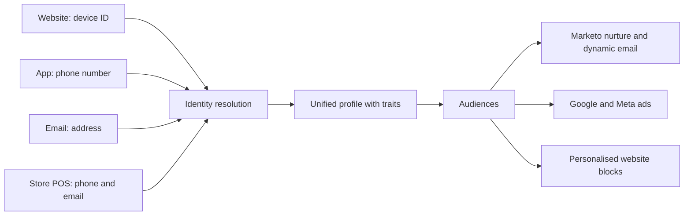
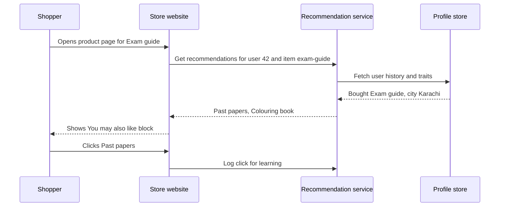
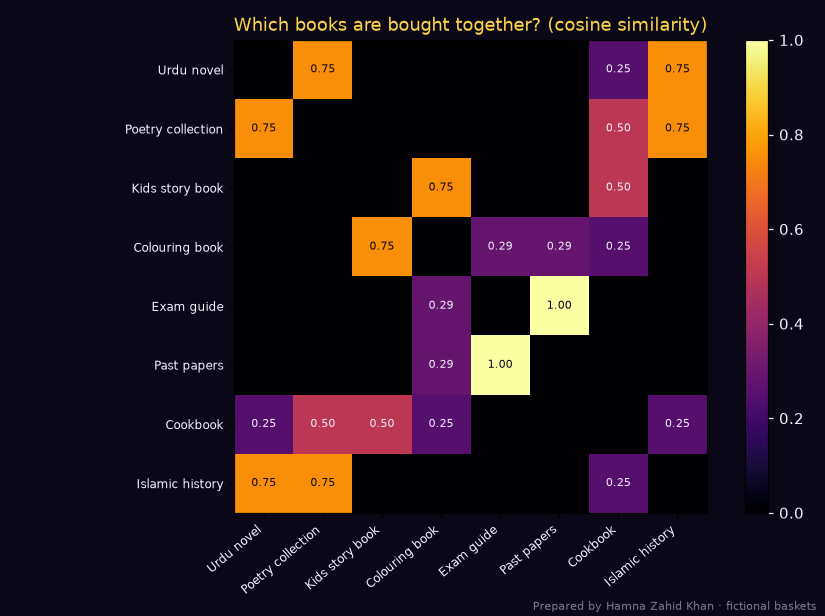
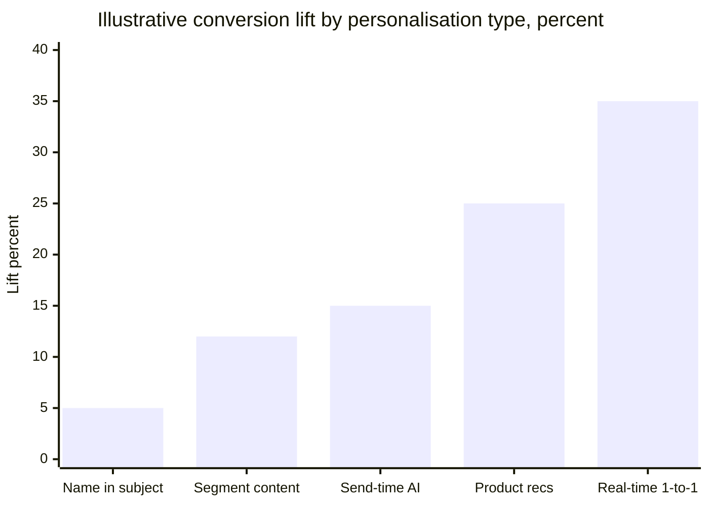

# Session 3 · Personalizing Marketing with AI

> 🏠 [Diploma in Digital Marketing](../../README.md) › [Term 1](../README.md) › [Smart Digital Marketing with AI](README.md) › **Session 3**
>
> ⏱ **Estimated time:** 3 hours (1.5 h theory + 1.5 h lab) · 📋 **Prerequisites:** Session 2

[⬅ Previous: Session 2](session-02-knowing-customers-with-ai.md) · [Next: Session 4 ➡](session-04-ai-in-marketing-activities.md)

---

## 🎯 Learning objectives

By the end of this session you will be able to:

- Illustrate how AI **personalises** marketing by creating content and experiences aligned with each customer's preferences.
- Explain how **digital customer profiles** are built with a customer data platform (CDP) such as **Segment**, and how **Marketo** uses them for segmentation and targeting.
- Build an item-to-item **recommendation engine** and explain how it powers "you may also like".
- Analyse **search behaviour** and plan targeted content with an AI content tool such as **Surfer SEO**.
- Summarise how AI improves customer experience by analysing and predicting behaviour.

## 📖 Concepts

### 1. Levels of personalisation

| Level | What changes | Example |
|---|---|---|
| **Mass** | Nothing – everyone sees the same | One billboard on Shahrah-e-Faisal |
| **Segmented** | Message per group | Separate emails for students and parents |
| **Personalised** | Fields per person | "Salam Sana, your size M is back in stock" |
| **1:1 / AI-driven** | Products, content, timing, channel and offer per person, in real time | App home screen re-orders categories for each user; email sent at each person's best hour |

**What AI personalises:** product recommendations, website and app content blocks, email subject lines and send times, push/WhatsApp timing, search results ranking, ad creative combinations, offers and price bands, chatbot answers.

### 2. Digital customer profiles and CDPs

A **customer data platform (CDP)** collects events from every touchpoint and joins them into **one profile per person**.

| CDP step | What happens | Segment (Twilio) term |
|---|---|---|
| **Collect** | Track events from website, app, server, POS, support tools | Sources, `track()`, `identify()` calls |
| **Clean and govern** | Enforce a tracking plan; block bad or sensitive data | Protocols |
| **Identity resolution** | Stitch device IDs, emails and phone numbers into one person | Unify / identity graph |
| **Compute traits** | Total spend, last category viewed, predicted churn | Computed and predictive traits |
| **Build audiences** | Rules such as "viewed bridal wear 3+ times, no purchase" | Audiences / Engage |
| **Activate** | Send profiles and audiences to email, ads, CRM | Destinations (Marketo, Google Ads, Meta, HubSpot) |

**Identity resolution** is the clever part: a visitor browses on a laptop (cookie only), signs up with email, later uses the app with a phone number, and pays in-store with both. The CDP links these identifiers into one profile – deterministic matching on email/phone, sometimes probabilistic matching on device signals.

### 3. Marketo for advanced segmentation and targeting

| Marketo feature | Use |
|---|---|
| **Smart Lists** | Dynamic filters on demographics + behaviour ("visited pricing page twice in 7 days") |
| **Segmentations** | Mutually exclusive groups that drive **dynamic content** in emails and landing pages |
| **Behavioural lead scoring** | Points for actions (webinar attended +15, pricing page +10, unsubscribe −50) |
| **Engagement programs (nurtures)** | Streams of content that adapt as people engage |
| **Predictive Audiences / Content (AI)** | Suggest who is likely to convert and which asset to show next |
| **Account-based marketing** | Target whole companies for B2B (software house selling to banks) |

### 4. Recommendation engines

| Approach | Idea | Strength | Weakness |
|---|---|---|---|
| **Popularity** | Show best-sellers | Works for new users | Not personal |
| **Content-based** | Recommend items similar in attributes (colour, fabric, author) | Works for new items | Narrow, repetitive |
| **Collaborative filtering** | "People who bought X also bought Y" from behaviour | Finds surprising links | Needs data; cold start |
| **Hybrid / deep learning** | Combine all, plus context (time, device, location) | Best accuracy | Complex |

**Cosine similarity** between two items = how often they're bought by the same people, scaled from 0 (never together) to 1 (always together).

### 5. Search behaviour and content personalisation

AI content tools such as **Surfer SEO**, Clearscope or Frase analyse the pages already ranking for a keyword and tell you which **topics, terms, questions, headings and length** your page needs to satisfy searchers. This is personalisation at the level of **search intent**: you write the page the searcher actually wants.

| Search intent | Example query (Pakistan) | Content to create |
|---|---|---|
| Informational | "best time to visit Hunza" | Guide with months, weather, photos |
| Commercial | "Hunza tour packages from Lahore" | Comparison page with prices and inclusions |
| Transactional | "book Hunza tour 5 days" | Booking page with dates, price, WhatsApp button |
| Local | "travel agent near me Gulberg" | Google Business Profile, local landing page |

## 🧭 Diagrams

### From scattered data to one personalised experience



### Request flow of a real-time recommendation



## 💻 Worked examples

### Example 1 – Stitching identities into unified profiles

Nine raw events from five sources of a fictional fashion brand. The code links identifiers that appear together (union-find), then computes traits and audiences:

📄 `code/session-03_customer_profile.py`

```python
# Building unified digital customer profiles, the way a customer data platform (CDP) such as Segment does:
# collect events from many sources, stitch identities (device -> phone -> email), then compute traits
# and audiences. Prepared by Hamna Zahid Khan, Junior Lecturer. All people and numbers are fictional.
from collections import defaultdict

events = [  # source, identifiers seen, event, properties
    ("website",  {"device": "d-101"},                              "page_view", {"page": "/kurtas"}),
    ("website",  {"device": "d-101", "email": "sana@example.pk"},  "signup",    {}),
    ("app",      {"device": "a-555", "phone": "+923001112233"},    "add_to_cart", {"item": "lawn-3pc", "price": 6500}),
    ("whatsapp", {"phone": "+923001112233"},                       "message",   {"text": "Is COD available in Multan?"}),
    ("store_pos",{"phone": "+923001112233", "email": "sana@example.pk"}, "purchase", {"amount": 6500, "city": "Multan"}),
    ("email",    {"email": "sana@example.pk"},                     "email_open", {"campaign": "eid-preview"}),
    ("website",  {"device": "d-202"},                              "page_view", {"page": "/men/shalwar-kameez"}),
    ("website",  {"device": "d-202", "email": "bilal@example.pk"}, "purchase",  {"amount": 4200, "city": "Lahore"}),
    ("app",      {"device": "a-777"},                              "page_view", {"page": "/kids"}),
]

# Union-find over identifiers: any event that shows two identifiers links them to one person
parent = {}
def find(x):
    parent.setdefault(x, x)
    while parent[x] != x:
        parent[x] = parent[parent[x]]; x = parent[x]
    return x
def union(a, b):
    parent[find(a)] = find(b)

for _, ids, _, _ in events:
    keys = [f"{k}:{v}" for k, v in ids.items()]
    for k in keys: find(k)
    for k in keys[1:]: union(keys[0], k)

profiles = defaultdict(lambda: {"ids": set(), "sources": set(), "events": [], "revenue": 0, "city": None})
for src, ids, ev, props in events:
    root = find(f"{next(iter(ids))}:{next(iter(ids.values()))}")
    p = profiles[root]
    p["ids"].update(f"{k}:{v}" for k, v in ids.items()); p["sources"].add(src); p["events"].append(ev)
    p["revenue"] += props.get("amount", 0)
    p["city"] = props.get("city", p["city"])

print(f"{len(events)} raw events from 5 sources -> {len(profiles)} unified profiles\n")
for i, p in enumerate(profiles.values(), 1):
    traits = {
        "known": any(x.startswith(("email", "phone")) for x in p["ids"]),
        "buyer": p["revenue"] > 0,
        "omnichannel": len(p["sources"]) >= 3,
    }
    audiences = []
    if traits["buyer"] and traits["omnichannel"]: audiences.append("VIP omnichannel")
    if "add_to_cart" in p["events"] and not traits["buyer"]: audiences.append("Cart abandoners")
    if not traits["known"]: audiences.append("Anonymous - retarget only")
    if traits["buyer"] and not traits["omnichannel"]: audiences.append("Single-channel buyers")
    print(f"Profile {i}: ids={sorted(p['ids'])}")
    print(f"  sources={sorted(p['sources'])} events={len(p['events'])} revenue=PKR {p['revenue']:,} city={p['city']}")
    print(f"  audiences={audiences}\n")
```

**Output**

```text
9 raw events from 5 sources -> 3 unified profiles

Profile 1: ids=['device:a-555', 'device:d-101', 'email:sana@example.pk', 'phone:+923001112233']
  sources=['app', 'email', 'store_pos', 'website', 'whatsapp'] events=6 revenue=PKR 6,500 city=Multan
  audiences=['VIP omnichannel']

Profile 2: ids=['device:d-202', 'email:bilal@example.pk']
  sources=['website'] events=2 revenue=PKR 4,200 city=Lahore
  audiences=['Single-channel buyers']

Profile 3: ids=['device:a-777']
  sources=['app'] events=1 revenue=PKR 0 city=None
  audiences=['Anonymous - retarget only']
```

**What happened:** Sana's laptop cookie, app device, phone and email were joined because some event showed two of them together (sign-up, in-store purchase). Her profile now has **six events across five sources** and lands in "VIP omnichannel"; the anonymous app user can only be retargeted until they identify themselves. This is exactly what a CDP does at the scale of millions of events.

### Example 2 – "You may also like" with collaborative filtering

Twelve customers' baskets at an online bookshop:

📄 `code/session-03_recommender.py`

```python
# "Customers who bought this also bought": an item-to-item recommender (collaborative filtering)
# using cosine similarity. Prepared by Hamna Zahid Khan, Junior Lecturer. Fictional baskets of an online bookshop.
import numpy as np
import matplotlib
matplotlib.use("Agg")
import matplotlib.pyplot as plt

BG, FIRE, GOLD, VIOLET, EMBER, TEXT = "#0A0716", "#FF6B1A", "#FCD34D", "#A78BFA", "#F43F5E", "#F5EEFF"

items = ["Urdu novel", "Poetry collection", "Kids story book", "Colouring book",
         "Exam guide", "Past papers", "Cookbook", "Islamic history"]
baskets = [  # one row per customer, 1 = bought
    [1, 1, 0, 0, 0, 0, 0, 1], [1, 1, 0, 0, 0, 0, 1, 0], [0, 0, 1, 1, 0, 0, 0, 0],
    [0, 0, 1, 1, 0, 0, 1, 0], [0, 0, 0, 0, 1, 1, 0, 0], [0, 0, 0, 1, 1, 1, 0, 0],
    [1, 0, 0, 0, 0, 0, 0, 1], [1, 1, 0, 0, 0, 0, 0, 1], [0, 0, 1, 1, 0, 0, 0, 0],
    [0, 0, 0, 0, 1, 1, 0, 0], [0, 1, 0, 0, 0, 0, 1, 1], [0, 0, 1, 0, 0, 0, 1, 0],
]
M = np.array(baskets, dtype=float)
norms = np.linalg.norm(M, axis=0)
sim = (M.T @ M) / np.outer(norms, norms)
np.fill_diagonal(sim, 0)

print("Item-to-item similarity (cosine, 0 = never together, 1 = always together):")
print(" " * 18 + " ".join(f"{i[:6]:>6}" for i in items))
for i, row in zip(items, sim):
    print(f"{i:<18}" + " ".join(f"{v:6.2f}" for v in row))

def recommend(owned, k=2):
    scores = sim[:, owned].sum(axis=1)
    scores[owned] = -1
    return [(items[j], round(float(scores[j]), 2)) for j in np.argsort(-scores)[:k]]

for who, owned in [("Ayesha (bought Urdu novel)", [0]), ("Hamza (bought Exam guide)", [4]),
                   ("Fatima (bought Kids story book + Cookbook)", [2, 6])]:
    print(f"\n{who} -> recommend {recommend(owned)}")

fig, ax = plt.subplots(figsize=(7.5, 5.6), facecolor=BG); ax.set_facecolor(BG)
im = ax.imshow(sim, cmap="inferno", vmin=0, vmax=1)
ax.set_xticks(range(len(items))); ax.set_xticklabels(items, rotation=40, ha="right", color=TEXT, fontsize=8)
ax.set_yticks(range(len(items))); ax.set_yticklabels(items, color=TEXT, fontsize=8)
for i in range(len(items)):
    for j in range(len(items)):
        if sim[i, j] > 0:
            ax.text(j, i, f"{sim[i, j]:.2f}", ha="center", va="center", fontsize=7, color=BG if sim[i, j] > 0.6 else TEXT)
ax.set_title("Which books are bought together? (cosine similarity)", color=GOLD)
cb = fig.colorbar(im, ax=ax, fraction=0.046); cb.ax.tick_params(colors=TEXT)
fig.text(0.99, 0.01, "Prepared by Hamna Zahid Khan · fictional baskets", color=TEXT, alpha=0.5, ha="right", fontsize=7)
plt.tight_layout(); plt.savefig("session-03_similarity_heatmap.png", dpi=110, facecolor=BG)
print("\nSaved session-03_similarity_heatmap.png")
```

**Output**

```text
Item-to-item similarity (cosine, 0 = never together, 1 = always together):
                  Urdu n Poetry Kids s Colour Exam g Past p Cookbo Islami
Urdu novel          0.00   0.75   0.00   0.00   0.00   0.00   0.25   0.75
Poetry collection   0.75   0.00   0.00   0.00   0.00   0.00   0.50   0.75
Kids story book     0.00   0.00   0.00   0.75   0.00   0.00   0.50   0.00
Colouring book      0.00   0.00   0.75   0.00   0.29   0.29   0.25   0.00
Exam guide          0.00   0.00   0.00   0.29   0.00   1.00   0.00   0.00
Past papers         0.00   0.00   0.00   0.29   1.00   0.00   0.00   0.00
Cookbook            0.25   0.50   0.50   0.25   0.00   0.00   0.00   0.25
Islamic history     0.75   0.75   0.00   0.00   0.00   0.00   0.25   0.00

Ayesha (bought Urdu novel) -> recommend [('Poetry collection', 0.75), ('Islamic history', 0.75)]

Hamza (bought Exam guide) -> recommend [('Past papers', 1.0), ('Colouring book', 0.29)]

Fatima (bought Kids story book + Cookbook) -> recommend [('Colouring book', 1.0), ('Poetry collection', 0.5)]

Saved session-03_similarity_heatmap.png
```



**Reading it:** Exam guide ↔ Past papers = **1.00** (always bought together), so every exam-guide buyer should see past papers. Fatima owns two items, so scores are **added** across both – Colouring book wins because it's linked to Kids story book. With real data you would also filter out items the customer already owns and out-of-stock items.

### Example 3 – Scoring a draft page against top results (Surfer-style)

A Lahore travel agency's draft for "Hunza travel guide" compared with three (invented) top-ranking pages:

📄 `code/session-03_content_score.py`

```python
# A content-optimisation score in the style of tools like Surfer SEO: compare your draft with the
# words that top-ranking pages use, then list gaps. Prepared by Hamna Zahid Khan, Junior Lecturer.
# The "competitor" texts below are short invented samples, not real pages.
import re
from collections import Counter

competitors = [
    "Best time to visit Hunza is April for cherry blossom and October for autumn colours. Karakoram Highway road trip, "
    "hotels in Karimabad, Attabad Lake boating, Eagle's Nest sunrise, travel cost and itinerary for 5 days.",
    "Hunza travel guide: how to reach by road or flight to Gilgit, Karakoram Highway, Attabad Lake, Passu Cones, "
    "Baltit Fort, hotels in Karimabad, best time to visit, 5 day itinerary and budget in PKR.",
    "Plan your Hunza trip: itinerary, Attabad Lake, Khunjerab Pass, Passu, best time to visit, weather, hotels, "
    "road conditions on Karakoram Highway, packing list and cost per person.",
]
draft = ("Hunza is beautiful. Our tour visits Attabad Lake and Baltit Fort. Book our Hunza tour today, "
         "we have the best Hunza tour packages with comfortable hotels.")

STOP = set("the and for to in of by or on a is are we our has have with how your per day".split())
def terms(text):
    words = [w for w in re.findall(r"[a-z']+", text.lower()) if w not in STOP and len(w) > 2]
    grams = words + [" ".join(p) for p in zip(words, words[1:])]
    return Counter(grams)

comp_counts = [terms(t) for t in competitors]
# a term matters if at least 2 of 3 top pages use it
important = sorted({t for c in comp_counts for t in c if sum(t in d for d in comp_counts) >= 2})
d = terms(draft)
covered = [t for t in important if t in d]
missing = [t for t in important if t not in d]
words_draft = len(draft.split()); words_avg = sum(len(t.split()) for t in competitors) / len(competitors)
stuffing = d.most_common(1)[0]

score = round(70 * len(covered) / len(important) + 30 * min(1, words_draft / words_avg))
print(f"Important terms used by 2+ top pages: {len(important)}")
print(f"Covered in draft: {len(covered)} -> {covered}")
print(f"Missing: {missing}")
print(f"Draft length {words_draft} words vs competitor average {words_avg:.0f}")
print(f"Most repeated term in draft: '{stuffing[0]}' x{stuffing[1]} (watch for keyword stuffing)")
print(f"Content score: {score}/100")
```

**Output**

```text
Important terms used by 2+ top pages: 21
Covered in draft: 6 -> ['attabad', 'attabad lake', 'best', 'hotels', 'hunza', 'lake']
Missing: ['best time', 'cost', 'highway', 'hotels karimabad', 'itinerary', 'karakoram', 'karakoram highway', 'karimabad', 'passu', 'road', 'time', 'time visit', 'travel', 'trip', 'visit']
Draft length 26 words vs competitor average 32
Most repeated term in draft: 'hunza' x3 (watch for keyword stuffing)
Content score: 44/100
```

**Lab walkthrough in Surfer SEO (or a free alternative):**

1. Open **Content Editor**, enter the keyword "Hunza travel guide" and location **Pakistan**.
2. Surfer analyses top results and shows a **content score**, target word count, headings count and a list of **terms to use** with suggested frequency.
3. Paste your draft. Add the missing topics naturally: *best time to visit*, *Karakoram Highway*, *Karimabad hotels*, *itinerary*, *cost*, *Passu*.
4. Add an **FAQ** answering "People also ask" questions – these match real search behaviour.
5. Don't stuff: our draft repeats "Hunza tour" three times in two sentences while covering only 6 of 21 important terms. A good page **covers topics**, it doesn't repeat one phrase.
6. Re-check the score; aim for the competitor range, then publish and monitor in Search Console.

### Example 4 – Measuring personalisation lift (hand calculation)

An app sends 40,000 users personalised recommendations and holds back 10,000 users (control) who see best-sellers.

| Group | Users | Buyers | Conversion | Revenue |
|---|---|---|---|---|
| Personalised | 40,000 | 1,480 | 3.70% | PKR 5,180,000 |
| Control | 10,000 | 290 | 2.90% | PKR 957,000 |

- Relative lift = (3.70 − 2.90) ÷ 2.90 = **+27.6%**.
- Revenue per user: personalised 5,180,000 ÷ 40,000 = PKR 129.5; control 957,000 ÷ 10,000 = PKR 95.7 → **+PKR 33.8 per user**.
- Incremental revenue from the personalised group ≈ 33.8 × 40,000 = **PKR 1.35 million** – the number that justifies the recommendation tool's cost.

## 📊 Chart · Typical lift by personalisation type (illustrative ranges from industry case studies)



## 📋 Checklist · Launching a personalisation programme

- [ ] Clear goal and KPI (conversion, AOV, retention) with a **control group**.
- [ ] Tracking plan: events and properties named consistently on web, app and server.
- [ ] Consent captured and respected for each channel.
- [ ] Identity strategy: what identifiers you collect and how they're matched.
- [ ] At least three audiences with distinct content (not just a first name).
- [ ] Fallback content for unknown users and cold-start items.
- [ ] Frequency caps so people aren't over-messaged.
- [ ] Monthly review of lift, complaints and unsubscribes.

## ⚠️ Common mistakes

| Mistake | Fix |
|---|---|
| Personalising only the first name | Personalise **what** you offer and **when**, not just the greeting |
| "Creepy" personalisation (mentioning sensitive browsing) | Avoid sensitive categories; be transparent about why content is shown |
| Recommending what the customer already bought | Exclude owned items, except consumables |
| No control group | Hold out 5–10% to measure true lift |
| Siloed data – email tool and app don't share profiles | Use a CDP or at least one shared customer ID |
| Writing for the tool, not the reader | Use content-score suggestions as a guide; readability first |

## ✅ Best practices

- Start with high-value moments: welcome series, cart recovery, back-in-stock, post-purchase cross-sell.
- Combine **behaviour + context** (city, weather, Ramadan timings, payday) for relevance.
- Keep product data rich (category, size, colour, price band) – recommendations are only as good as the catalogue.
- Let customers control preferences in a preference centre.

## 🧪 Lab / practice tasks

**Task 1 (easy) – Level spotting.** Classify: (a) "Dear Customer" newsletter, (b) separate offers for Karachi and Lahore, (c) app home screen showing each user's favourite categories first.

<details><summary>✅ Solution</summary>

(a) Mass · (b) Segmented · (c) 1:1 AI-driven.

</details>

**Task 2 (easy) – Lift.** Personalised group CR 4.2%, control 3.5%. What is the relative lift?

<details><summary>✅ Solution</summary>

(4.2 − 3.5) ÷ 3.5 = **20%**.

</details>

**Task 3 (medium) – Extend the profile code.** Add an event `("website", {"device": "a-777", "email": "zara@example.pk"}, "signup", {})` to `code/session-03_customer_profile.py`. How do the number of profiles and the anonymous profile's audiences change?

<details><summary>💡 Hint</summary>

Still 3 profiles, but profile 3 is now **known** (has an email), so it leaves "Anonymous - retarget only" and gets no audience until it buys or adds to cart – think about which new audience (e.g. "New sign-ups") you should add.

</details>

**Task 4 (medium) – Recommend for a new customer.** In `code/session-03_recommender.py`, recommend three items for someone who bought "Poetry collection" and "Cookbook". Explain the result.

<details><summary>💡 Hint</summary>

Call `recommend([1, 6], k=3)`. Urdu novel and Islamic history score highly from Poetry; Kids story book gets a boost from Cookbook.

</details>

**Task 5 (challenge) – Content brief.** Pick a keyword for a Pakistani business (e.g. "best laptop for students under 150000"). Use Surfer SEO's free trial, or manually review the top 5 Google results, to build a content brief: intent, H2 headings, must-cover terms, FAQs, word count, internal links and CTA.

## ✅ Quick quiz

1. A CDP's identity resolution:
   a) designs logos b) links device IDs, emails and phones into one profile c) sets ad bids d) writes captions
2. In Marketo, a Smart List is:
   a) a static spreadsheet b) a dynamic list filtered by attributes and behaviour c) an ad format d) a chatbot
3. "Customers who bought X also bought Y" is:
   a) content-based filtering b) collaborative filtering c) popularity ranking d) A/B testing
4. Surfer SEO helps mainly by:
   a) sending emails b) analysing top-ranking pages to guide content coverage c) designing logos d) buying backlinks
5. To prove personalisation works you need:
   a) more emojis b) a control group c) a bigger logo d) only open rates

<details><summary>Show answers</summary>

1-b · 2-b · 3-b · 4-b · 5-b

</details>

## 📝 Summary

- Personalisation moves from **mass → segmented → personalised → 1:1 AI-driven**.
- **CDPs** like Segment collect, clean, **stitch identities**, compute traits, build audiences and activate them in tools like **Marketo**.
- Marketo personalises with **Smart Lists, segmentations, lead scoring, nurtures** and predictive content.
- **Recommendation engines** use popularity, content similarity and collaborative filtering (cosine similarity).
- **Surfer-style content analysis** aligns pages with search intent – cover topics, don't stuff keywords.
- Measure everything with a **control group** and respect privacy.

**Interview / viva questions**

1. What is a customer data platform and how does it differ from a CRM?
2. Explain identity resolution with an example.
3. How would you use Marketo Smart Lists and lead scoring for a university admissions campaign?
4. Compare content-based and collaborative recommendations.
5. How does an AI content tool help you match search intent?
6. When does personalisation become "creepy" and how do you avoid it?

---

[⬅ Previous: Session 2](session-02-knowing-customers-with-ai.md) · [Next: Session 4 ➡](session-04-ai-in-marketing-activities.md)

<sub>Prepared by **Hamna Zahid Khan**, Junior Lecturer · Diploma in Digital Marketing</sub>
