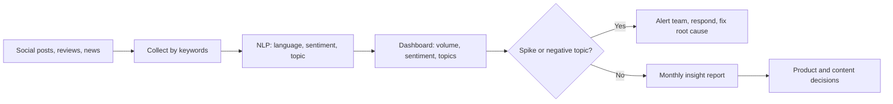
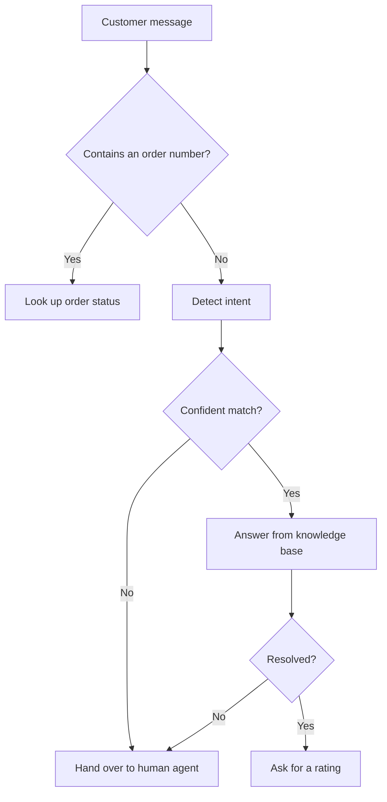
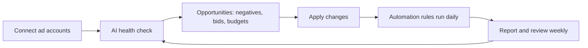
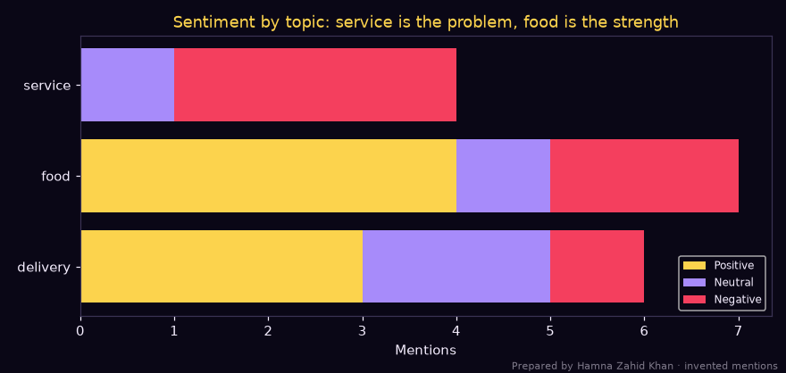
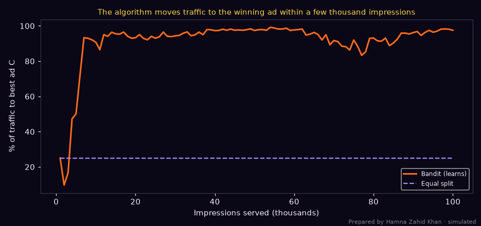
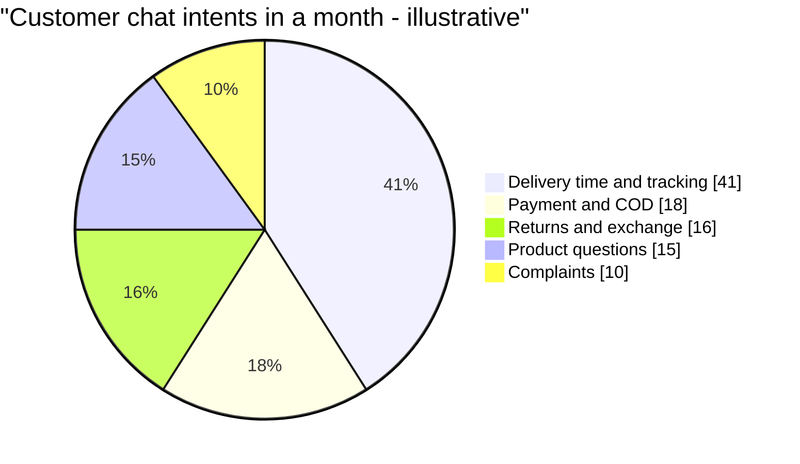

# Session 4 · AI in Everyday Marketing Activities

> 🏠 [Diploma in Digital Marketing](../../README.md) › [Term 1](../README.md) › [Smart Digital Marketing with AI](README.md) › **Session 4**
>
> ⏱ **Estimated time:** 3 hours (1.5 h theory + 1.5 h lab) · 📋 **Prerequisites:** Session 3

[⬅ Previous: Session 3](session-03-personalizing-marketing-with-ai.md) · [Next: Session 5 ➡](session-05-ethical-ai-and-future-trends.md)

---

## 🎯 Learning objectives

By the end of this session you will be able to:

- Illustrate how **Hootsuite Insights** (and similar tools) monitor social media and run **sentiment analysis**, and how **Jasper AI** generates marketing copy and personalised content.
- Define how AI improves **customer service** through chatbots and virtual assistants, and design a simple bot flow.
- Explain the process of creating and optimising a digital advertising campaign with an AI tool such as **Adzooma**.
- Summarise how AI analyses **market trends** and streamlines **logistics** to support product development.

## 📖 Concepts

### 1. Social listening and sentiment analysis

**Social monitoring** tracks mentions of your brand; **social listening** goes further and asks *what do these conversations mean?* **Hootsuite Insights** (powered by Talkwalker) scans social networks, blogs, news and forums for keywords and uses NLP to report:

| Output | What it tells you |
|---|---|
| **Mention volume** | How much people talk about you (and competitors) over time |
| **Sentiment** (positive / neutral / negative) | How they feel |
| **Topics and themes** | What they talk about (delivery, price, quality) |
| **Demographics and locations** | Who is talking, where |
| **Influencers** | Accounts with big reach in your conversation |
| **Alerts** | Sudden spikes that may be a crisis or a viral moment |

**How sentiment AI works:** simple systems use a **lexicon** (lists of positive/negative words, with rules for negation like "not bad"); modern systems use **machine-learning or transformer models** trained on labelled posts, which handle context and sarcasm better. In Pakistan, many posts mix English, Urdu script and **Roman Urdu** ("maza aa gaya", "bekar service"), so a tool must be tested on local language before you trust it.

### 2. Generative AI for copy and content – Jasper and friends

**Jasper AI** is a marketing-focused generative AI platform (others: ChatGPT, Gemini, Claude, Copy.ai, Canva Magic Write). Marketers use it to:

| Use | Example prompt |
|---|---|
| Ad copy variants | "Write 5 Google Ads headlines under 30 characters for a Karachi coaching centre's MDCAT crash course" |
| Social captions | "Write 3 Instagram captions in friendly Roman Urdu-English mix for a chai café's monsoon special" |
| Email personalisation | "Rewrite this welcome email for three segments: students, parents, working professionals" |
| Product descriptions | "Describe this 3-piece lawn suit: fabric, colours, care, sizes, in 80 words" |
| Repurposing | "Turn this blog post into a LinkedIn post and a 30-second reel script" |

**Jasper's marketing features:** **Brand Voice** (upload style guides so output sounds like you), **Knowledge** (product facts), templates, campaigns that create a set of assets at once, and team workflows.

**A strong prompt (the RCTFC pattern):**

| Part | Example |
|---|---|
| **Role** | "You are a senior copywriter for a Pakistani fintech app." |
| **Context** | "Audience: university students in Lahore; benefit: free instant transfers." |
| **Task** | "Write 5 push notifications." |
| **Format** | "Max 60 characters each, one emoji, numbered list." |
| **Constraints** | "No exaggerated claims, no 'guaranteed', include the word 'free'." |

> ⚠️ Generative AI can **invent facts** ("hallucinate"), copy styles too closely, or miss cultural nuance. Always fact-check prices, claims and religious/cultural references, and edit for brand voice.

### 3. Chatbots and virtual assistants

| Type | How it works | Best for |
|---|---|---|
| **Rule-based / menu bot** | Buttons and keywords lead down a decision tree | FAQs, order tracking, simple bookings |
| **AI (NLP) bot** | Detects **intent** and **entities** from free text | Varied questions, multiple languages |
| **Generative AI assistant** | Large language model answers from your knowledge base (retrieval-augmented) | Complex queries, product advice |
| **Voice assistant** | Speech-to-text + NLP | Call-centre IVR, smart speakers |

**Key terms:** *intent* = what the user wants (track order); *entity* = details (order number, city); *fallback / handover* = passing to a human when the bot isn't confident; *containment rate* = % of conversations solved without a human.

In Pakistan, **WhatsApp Business API** bots are the most common: banks, telecoms, food chains and e-commerce stores answer delivery, payment (COD, JazzCash, Easypaisa) and return questions 24/7.

### 4. AI-optimised advertising – Adzooma

**Adzooma** connects to Google Ads, Microsoft Ads and Meta Ads and uses AI to find and apply improvements. The typical process:

1. **Connect accounts** and set goals (CPA, ROAS, budget).
2. **Health check / Opportunities** – the AI scans for issues: wasted spend on non-converting keywords, missing negative keywords, low Quality Score ads, budget-limited campaigns, ad groups with only one ad.
3. **One-click optimisations** – apply suggested changes (pause poor keywords, add negatives, adjust bids).
4. **Automation rules** – e.g. "if CPA > PKR 1,500 for 7 days, reduce bid 15%"; "pause ads with CTR < 0.5% after 2,000 impressions".
5. **Performance reports** – cross-platform dashboards for clients.

Behind tools like this – and inside Google Smart Bidding and Meta Advantage+ – are algorithms that **learn which ads, audiences and bids work best while the campaign runs**. A classic one is the **multi-armed bandit**: instead of splitting traffic equally for weeks (A/B test), it gradually sends more traffic to the ad that is winning while still exploring the others.

### 5. AI for market trends, product development and logistics

| Area | AI technique | Example |
|---|---|---|
| **Trend detection** | Topic modelling on social/search data | Rising searches for "pistachio kunafa" spark a new dessert at a bakery chain |
| **Product development** | Review mining and sentiment on features | Customers complain lawn fabric fades → supplier change |
| **Demand forecasting** | Time-series models with seasonality and events | Stock air coolers before May heatwaves |
| **Inventory optimisation** | Predict stock per warehouse | Move winter shawls to Islamabad warehouse before November |
| **Route optimisation** | Algorithms choosing delivery routes | Riders in Karachi deliver more orders per hour |
| **Dynamic pricing** | Models balancing demand and stock | Flash-sale prices on slow-moving sizes |

## 🧭 Diagrams

### Social listening to action



### Chatbot conversation logic



### Adzooma-style optimisation cycle



## 💻 Worked examples

### Example 1 – Sentiment and topic analysis on brand mentions

Twelve invented mentions of a food-delivery brand, in English and Roman Urdu, scored with a lexicon that understands negation:

📄 `code/session-04_social_sentiment.py`

```python
# Social listening with sentiment analysis, the core idea behind tools like Hootsuite Insights:
# score each mention, group by topic, and flag issues. Works on English and Roman Urdu with a small lexicon.
# Prepared by Hamna Zahid Khan, Junior Lecturer. Mentions are invented for an illustrative food-delivery brand.
import re
from collections import defaultdict
import matplotlib
matplotlib.use("Agg")
import matplotlib.pyplot as plt

BG, FIRE, GOLD, VIOLET, EMBER, TEXT = "#0A0716", "#FF6B1A", "#FCD34D", "#A78BFA", "#F43F5E", "#F5EEFF"
POS = {"love", "great", "fast", "tasty", "best", "amazing", "zabardast", "mazay", "maza", "acha", "achi", "fresh", "shukriya", "kamaal"}
NEG = {"late", "cold", "worst", "rude", "bad", "bekar", "ganda", "slow", "missing", "refund", "never", "ghatiya", "wrong"}
NEGATORS = {"not", "nahi", "na", "never"}
TOPICS = {"delivery": {"late", "delivery", "rider", "fast", "slow", "time"},
          "food": {"food", "cold", "tasty", "fresh", "biryani", "pizza", "maza", "mazay", "burger"},
          "service": {"rude", "support", "refund", "missing", "wrong", "helpline", "app"}}

mentions = [
    "Biryani was zabardast and delivery was fast, love it",
    "Rider came 50 minutes late and the pizza was cold",
    "Worst support ever, still waiting for my refund",
    "Burger maza aa gaya, fresh and tasty",
    "App is not bad but delivery time is slow in Gulshan",
    "Order missing items again, helpline is rude",
    "Shukriya for the quick delivery, kamaal service",
    "Food acha tha lekin rider late tha",
    "Pizza not fresh, bekar experience",
    "Best deal on Friday, amazing biryani",
    "Wrong order delivered, refund nahi mila",
    "Fast delivery in DHA, tasty food",
]

def score(text):
    words = re.findall(r"[a-z]+", text.lower())
    s = 0
    for i, w in enumerate(words):
        v = (w in POS) - (w in NEG)
        if v and i and words[i - 1] in NEGATORS:
            v = -v                      # "not bad" -> positive, "not fresh" -> negative
        s += v
    return s, words

by_topic = defaultdict(lambda: [0, 0, 0])   # pos, neu, neg
total = [0, 0, 0]
for m in mentions:
    s, words = score(m)
    label = "POS" if s > 0 else "NEG" if s < 0 else "NEU"
    idx = {"POS": 0, "NEU": 1, "NEG": 2}[label]
    total[idx] += 1
    topics = [t for t, kw in TOPICS.items() if kw & set(words)] or ["other"]
    for t in topics: by_topic[t][idx] += 1
    print(f"[{label} {s:+d}] {m}  -> topics {topics}")

net = (total[0] - total[2]) / len(mentions) * 100
print(f"\nTotals: positive {total[0]}, neutral {total[1]}, negative {total[2]}  | net sentiment {net:+.0f}")
print("By topic (pos/neu/neg):")
for t, (p, n, g) in sorted(by_topic.items()):
    flag = "  <-- ALERT: more negative than positive" if g > p else ""
    print(f"  {t:<9} {p}/{n}/{g}{flag}")

fig, ax = plt.subplots(figsize=(8, 3.8), facecolor=BG); ax.set_facecolor(BG)
names = sorted(by_topic)
p = [by_topic[t][0] for t in names]; n = [by_topic[t][1] for t in names]; g = [by_topic[t][2] for t in names]
ax.barh(names, p, color=GOLD, label="Positive")
ax.barh(names, n, left=p, color=VIOLET, label="Neutral")
ax.barh(names, g, left=[a + b for a, b in zip(p, n)], color=EMBER, label="Negative")
ax.set_xlabel("Mentions", color=TEXT)
ax.set_title("Sentiment by topic: service is the problem, food is the strength", color=GOLD)
ax.tick_params(colors=TEXT)
for sp in ax.spines.values(): sp.set_color("#3b3355")
ax.legend(facecolor=BG, labelcolor=TEXT, fontsize=8, loc="lower right")
fig.text(0.99, 0.01, "Prepared by Hamna Zahid Khan · invented mentions", color=TEXT, alpha=0.5, ha="right", fontsize=7)
plt.tight_layout(); plt.savefig("session-04_sentiment_topics.png", dpi=110, facecolor=BG)
print("Saved session-04_sentiment_topics.png")
```

**Output**

```text
[POS +3] Biryani was zabardast and delivery was fast, love it  -> topics ['delivery', 'food']
[NEG -2] Rider came 50 minutes late and the pizza was cold  -> topics ['delivery', 'food']
[NEG -2] Worst support ever, still waiting for my refund  -> topics ['service']
[POS +3] Burger maza aa gaya, fresh and tasty  -> topics ['food']
[NEU +0] App is not bad but delivery time is slow in Gulshan  -> topics ['delivery', 'service']
[NEG -2] Order missing items again, helpline is rude  -> topics ['service']
[POS +2] Shukriya for the quick delivery, kamaal service  -> topics ['delivery']
[NEU +0] Food acha tha lekin rider late tha  -> topics ['delivery', 'food']
[NEG -2] Pizza not fresh, bekar experience  -> topics ['food']
[POS +2] Best deal on Friday, amazing biryani  -> topics ['food']
[NEG -2] Wrong order delivered, refund nahi mila  -> topics ['service']
[POS +2] Fast delivery in DHA, tasty food  -> topics ['delivery', 'food']

Totals: positive 5, neutral 2, negative 5  | net sentiment +0
By topic (pos/neu/neg):
  delivery  3/2/1
  food      4/1/2
  service   0/1/3  <-- ALERT: more negative than positive
Saved session-04_sentiment_topics.png
```



**Insight → action:** overall sentiment is balanced (net 0), which hides the real story: **service** has zero positive mentions (refunds, missing items, rude helpline) while **food** is the strength. Actions: fix refund turnaround, script helpline responses, and use food-quality praise in ads. Notice the limits too: "Food acha tha lekin rider late tha" (good food, late rider) scored neutral – real tools split sentiment **per aspect**.

### Example 2 – A customer-service bot with human handover

A WhatsApp-style FAQ bot for a fictional clothing store, understanding English and Roman Urdu keywords:

📄 `code/session-04_faq_chatbot.py`

```python
# A tiny customer-service chatbot: match the customer's message to an intent, answer, and hand over
# to a human when unsure. Real assistants use language models, but the flow is the same.
# Prepared by Hamna Zahid Khan, Junior Lecturer. Store details are fictional.
import re

INTENTS = {
    "delivery_time": ({"delivery", "kab", "when", "days", "arrive", "pohanch"},
                      "Karachi, Lahore and Islamabad: 2-3 working days. Other cities: 3-5 working days."),
    "cod":           ({"cod", "cash", "payment", "pay", "easypaisa", "jazzcash"},
                      "We accept cash on delivery, cards, JazzCash and Easypaisa."),
    "returns":       ({"return", "exchange", "wapis", "size", "refund"},
                      "Exchanges and returns are free within 7 days if tags are attached. Reply RETURN to start."),
    "order_status":  ({"order", "track", "status", "kahan", "where"},
                      "Please share your order number (e.g. ORD-12345) and I will check its status."),
    "greeting":      ({"hi", "hello", "salam", "aoa", "assalam"},
                      "Wa alaikum assalam! How can I help you today?"),
}
ORDERS = {"ORD-12345": "Dispatched from Lahore warehouse, with courier, expected tomorrow."}

def reply(msg):
    m = re.search(r"ORD-\d{5}", msg.upper())
    if m:
        return "order_lookup", ORDERS.get(m.group(), "I could not find that order. Connecting you to an agent.")
    words = set(re.findall(r"[a-z]+", msg.lower()))
    scores = {k: len(kw & words) for k, (kw, _) in INTENTS.items()}
    best = max(scores, key=scores.get)
    if scores[best] == 0:
        return "handover", "I am not sure I understood. Connecting you to a human agent (avg wait 3 min)."
    return best, INTENTS[best][1]

chat = ["Assalam o alaikum", "Mera parcel kab pohanchega Multan mein?", "Can I pay with JazzCash?",
        "Size chota hai, exchange ho sakta hai?", "Where is my order", "ord-12345",
        "My shirt colour faded after one wash, very disappointed"]
handovers = 0
for msg in chat:
    intent, ans = reply(msg)
    handovers += intent == "handover"
    print(f"Customer: {msg}\nBot [{intent}]: {ans}\n")
print(f"Contained by bot: {len(chat) - handovers}/{len(chat)} messages ({(len(chat) - handovers) / len(chat):.0%})")
```

**Output**

```text
Customer: Assalam o alaikum
Bot [greeting]: Wa alaikum assalam! How can I help you today?

Customer: Mera parcel kab pohanchega Multan mein?
Bot [delivery_time]: Karachi, Lahore and Islamabad: 2-3 working days. Other cities: 3-5 working days.

Customer: Can I pay with JazzCash?
Bot [cod]: We accept cash on delivery, cards, JazzCash and Easypaisa.

Customer: Size chota hai, exchange ho sakta hai?
Bot [returns]: Exchanges and returns are free within 7 days if tags are attached. Reply RETURN to start.

Customer: Where is my order
Bot [order_status]: Please share your order number (e.g. ORD-12345) and I will check its status.

Customer: ord-12345
Bot [order_lookup]: Dispatched from Lahore warehouse, with courier, expected tomorrow.

Customer: My shirt colour faded after one wash, very disappointed
Bot [handover]: I am not sure I understood. Connecting you to a human agent (avg wait 3 min).

Contained by bot: 6/7 messages (86%)
```

**Design lessons:**

- **Containment 86%** – six of seven messages were solved instantly, 24/7.
- The colour-fading complaint was correctly **handed to a human**: complaints need empathy and judgement, and a bad bot answer here could become a viral screenshot.
- An entity (order number) is extracted with a pattern, then used to look up live data.
- Next step for a real bot: log unanswered questions weekly and add new intents.

### Example 3 – Letting the algorithm move budget to the winning ad

Four ad variants with hidden true CTRs. A fixed equal split versus a **Thompson-sampling bandit** that learns from clicks:

📄 `code/session-04_ad_optimizer.py`

```python
# How AI ad tools (Adzooma, Google/Meta automated bidding) shift budget to winning ads automatically:
# a Thompson-sampling "multi-armed bandit" versus a fixed equal split. Prepared by Hamna Zahid Khan, Junior Lecturer.
# True click-through rates are hidden from the algorithm; it learns them from clicks. Numbers are illustrative.
import numpy as np
import matplotlib
matplotlib.use("Agg")
import matplotlib.pyplot as plt

BG, FIRE, GOLD, VIOLET, EMBER, TEXT = "#0A0716", "#FF6B1A", "#FCD34D", "#A78BFA", "#F43F5E", "#F5EEFF"
ADS = ["A: 'Flat 30% off'", "B: 'Free delivery Pakistan-wide'", "C: 'New Eid collection'", "D: 'Buy 2 get 1'"]
TRUE_CTR = np.array([0.010, 0.014, 0.022, 0.016])
IMPRESSIONS, BATCH = 100_000, 1_000
rng = np.random.default_rng(2)

def run(strategy):
    clicks, shown = np.zeros(4), np.zeros(4)
    share_c = []
    for _ in range(IMPRESSIONS // BATCH):
        if strategy == "equal":
            alloc = np.full(4, BATCH // 4)
        else:  # Thompson sampling: draw a plausible CTR for each ad from Beta(clicks+1, misses+1)
            draws = rng.beta(clicks + 1, shown - clicks + 1, size=(BATCH, 4))
            alloc = np.bincount(draws.argmax(axis=1), minlength=4)
        c = rng.binomial(alloc.astype(int), TRUE_CTR)
        clicks += c; shown += alloc
        share_c.append(alloc[2] / BATCH)
    return clicks, shown, share_c

for name in ["equal", "bandit"]:
    clicks, shown, share = run(name)
    print(f"{name.upper():<7} total clicks {clicks.sum():,.0f}  overall CTR {clicks.sum() / shown.sum():.2%}")
    for a, s, c in zip(ADS, shown, clicks):
        print(f"   {a:<32} impressions {s:>6,.0f}  clicks {c:>5,.0f}  CTR {c / max(s, 1):.2%}")
    if name == "equal": base = clicks.sum(); eq_share = share
    else: bandit_share = share; gain = clicks.sum() - base
cpc_budget = 25_000   # PKR
print(f"\nBandit gained {gain:+,.0f} clicks ({gain / base:+.0%}) from the same 100,000 impressions.")
print(f"With PKR {cpc_budget:,} spent on these impressions, cost per click falls from PKR {cpc_budget / base:.1f} to PKR {cpc_budget / (base + gain):.1f}")

fig, ax = plt.subplots(figsize=(8.5, 4), facecolor=BG); ax.set_facecolor(BG)
x = np.arange(1, len(eq_share) + 1) * BATCH / 1000
ax.plot(x, np.array(bandit_share) * 100, color=FIRE, lw=2, label="Bandit (learns)")
ax.plot(x, np.array(eq_share) * 100, color=VIOLET, ls="--", label="Equal split")
ax.set_xlabel("Impressions served (thousands)", color=TEXT)
ax.set_ylabel("% of traffic to best ad C", color=TEXT)
ax.set_title("The algorithm moves traffic to the winning ad within a few thousand impressions", color=GOLD, fontsize=10)
ax.tick_params(colors=TEXT)
for sp in ax.spines.values(): sp.set_color("#3b3355")
ax.legend(facecolor=BG, labelcolor=TEXT, fontsize=8)
fig.text(0.99, 0.01, "Prepared by Hamna Zahid Khan · simulated", color=TEXT, alpha=0.5, ha="right", fontsize=7)
plt.tight_layout(); plt.savefig("session-04_bandit_share.png", dpi=110, facecolor=BG)
print("Saved session-04_bandit_share.png")
```

**Output**

```text
EQUAL   total clicks 1,547  overall CTR 1.55%
   A: 'Flat 30% off'                impressions 25,000  clicks   249  CTR 1.00%
   B: 'Free delivery Pakistan-wide' impressions 25,000  clicks   331  CTR 1.32%
   C: 'New Eid collection'          impressions 25,000  clicks   575  CTR 2.30%
   D: 'Buy 2 get 1'                 impressions 25,000  clicks   392  CTR 1.57%
BANDIT  total clicks 2,092  overall CTR 2.09%
   A: 'Flat 30% off'                impressions  3,002  clicks    41  CTR 1.37%
   B: 'Free delivery Pakistan-wide' impressions  1,363  clicks    16  CTR 1.17%
   C: 'New Eid collection'          impressions 91,252  clicks 1,961  CTR 2.15%
   D: 'Buy 2 get 1'                 impressions  4,383  clicks    74  CTR 1.69%

Bandit gained +545 clicks (+35%) from the same 100,000 impressions.
With PKR 25,000 spent on these impressions, cost per click falls from PKR 16.2 to PKR 12.0
Saved session-04_bandit_share.png
```



**Interpretation:** the bandit gave **91% of impressions** to ad C ("New Eid collection") and earned **35% more clicks** from the same impressions, cutting cost per click from PKR 16.2 to PKR 12.0. The trade-off: a bandit maximises results *during* the campaign, while a classic A/B test gives cleaner evidence about *why* one ad won. Automated platforms do the bandit part for you – your job is to feed them **genuinely different creatives**.

### Example 4 – Jasper / generative AI copy workflow (walkthrough)

Task: Ramadan campaign for a Lahore restaurant's sehri deal.

1. **Brief** – set Brand Voice ("warm, family-focused, respectful, bilingual") and Knowledge (menu, prices, timings, branches).
2. **Prompt** – "Write 6 Instagram captions for our Sehri Platter (PKR 1,899 for 2, served 2 am–4:30 am, Gulberg and DHA). Mix English and Roman Urdu, respectful tone, end with a call to reserve on WhatsApp."
3. **Generate and shortlist** – pick 3; reject any with wrong timings or over-the-top claims.
4. **Human edit** – check religious sensitivity, prices and branch names; adjust for local idioms.
5. **Test** – run 2–3 captions as ad variants; let the platform's AI (or a bandit) allocate spend.
6. **Learn** – save winning phrases to the brand voice library.

**Time saved (worked numbers):** writing 30 captions manually ≈ 5 hours; AI draft + editing ≈ 1.5 hours. At a copywriter cost of PKR 1,500/hour that saves about **PKR 5,250 per campaign**, and more importantly gives more variants to test.

### Example 5 – Chatbot ROI (hand calculation)

A Karachi e-commerce store receives 18,000 customer chats a month; each human-handled chat costs PKR 60. A bot contains 65% of chats; the bot platform costs PKR 250,000/month.

| Item | Working | PKR |
|---|---|---|
| Cost without bot | 18,000 × 60 | 1,080,000 |
| Chats still handled by humans | 18,000 × 35% = 6,300 × 60 | 378,000 |
| Bot platform | | 250,000 |
| Cost with bot | 378,000 + 250,000 | 628,000 |
| **Monthly saving** | 1,080,000 − 628,000 | **452,000** |

Break-even containment = 250,000 ÷ (18,000 × 60) ≈ **23%** – below that, the bot costs more than it saves.

## 📊 Chart · Where customer queries come from (illustrative e-commerce chat log)



## 📋 Checklist · Responsible use of AI in daily marketing

- [ ] Sentiment model tested on 100+ local posts (including Roman Urdu) before trusting it.
- [ ] Generated copy fact-checked for prices, dates, claims and cultural/religious sensitivity.
- [ ] AI-written content labelled internally and edited for brand voice.
- [ ] Bot clearly says it's a bot and offers a human option.
- [ ] Bot never handles sensitive data (CNIC, card numbers) in plain chat.
- [ ] Automation rules have limits (max bid change, min data before pausing).
- [ ] Weekly human review of automated changes and bot failures.

## ⚠️ Common mistakes

| Mistake | Fix |
|---|---|
| Trusting overall sentiment | Break down by topic/aspect and read actual posts |
| Publishing AI copy without checks | Human fact-check and edit every time |
| Bots with no human escape | Always offer handover, especially for complaints |
| Applying every "opportunity" in an AI ad tool | Review suggestions against your strategy and data volume |
| Testing near-identical creatives | Give algorithms genuinely different hooks and visuals |
| Forecasting without events | Add Ramadan, Eid, 11.11, school terms and paydays |

## ✅ Best practices

- Pair every AI tool with a clear KPI: response time, CSAT, CTR, CPA, forecast error.
- Build a **prompt library** and **brand voice guide** for consistent generative output.
- Use listening insights in product meetings, not just social reports.
- Keep humans in charge of tone, crisis communication and ethics.

## 🧪 Lab / practice tasks

**Task 1 (easy) – Prompt rewrite.** Improve this weak prompt using RCTFC: "Write an ad for my shop."

<details><summary>✅ Solution</summary>

Example: "You are a performance copywriter for a Rawalpindi mobile-accessories shop (Role). Audience: students looking for budget earbuds; offer: 20% off, free delivery in Pindi/Islamabad this week (Context). Write 4 Facebook ad primary texts (Task) of max 125 characters, each with one emoji and a call to order on WhatsApp (Format). No fake reviews, no 'best in Pakistan' claims (Constraints)."

</details>

**Task 2 (easy) – Containment.** A bot handles 9,000 chats; 2,700 go to humans. What is the containment rate?

<details><summary>✅ Solution</summary>

(9,000 − 2,700) ÷ 9,000 = **70%**.

</details>

**Task 3 (medium) – Improve the sentiment lexicon.** In `code/session-04_social_sentiment.py`, add "lekin/but" handling so that only the words **after** "lekin" or "but" count (people's main point usually follows). How does "Food acha tha lekin rider late tha" change?

<details><summary>💡 Hint</summary>

Split the word list at the last occurrence of "lekin" or "but" and score only the second part. The example becomes negative (-1), which better reflects the complaint.

</details>

**Task 4 (medium) – New bot intent.** Add a `"store_location"` intent to `code/session-04_faq_chatbot.py` with keywords such as `branch, store, address, kahan, location` and test it with "Aapki branch kahan hai Lahore mein?". Watch out: "kahan" also appears in `order_status`. How do you resolve the clash?

<details><summary>💡 Hint</summary>

Ties go to the first intent in the dictionary. Add more specific keywords (branch, address), remove ambiguous ones from one intent, or ask a clarifying question when two intents score equally.

</details>

**Task 5 (challenge) – Bandit vs A/B.** Change `TRUE_CTR` in `code/session-04_ad_optimizer.py` so two ads are almost equal (0.020 and 0.021). Run it a few times with different seeds. What happens to the bandit's allocation, and what does that teach you about declaring winners?

## ✅ Quick quiz

1. Hootsuite Insights is mainly used for:
   a) editing photos b) social listening and sentiment analysis c) web hosting d) payroll
2. Jasper AI is best described as:
   a) an ad network b) a generative AI writing platform for marketing c) a CDP d) a CRM
3. "Containment rate" in chatbots means:
   a) the % of chats solved without a human b) the bot's typing speed c) the number of emojis d) the server uptime
4. A multi-armed bandit differs from an equal A/B split because it:
   a) never explores b) shifts traffic towards the better ad while running c) needs no data d) only works on email
5. Which is the best first step in an Adzooma-style optimisation?
   a) Delete all campaigns b) Connect accounts and run a health check against goals c) Double every budget d) Turn off tracking

<details><summary>Show answers</summary>

1-b · 2-b · 3-a · 4-b · 5-b

</details>

## 📝 Summary

- **Social listening** with sentiment and topic analysis reveals what people feel and why; test tools on Roman Urdu.
- **Generative AI** (Jasper and others) speeds up copy and personalisation – always fact-check and edit.
- **Chatbots** solve routine queries 24/7; design intents, entities and human handover; measure containment and CSAT.
- **AI ad tools** (Adzooma, Smart Bidding, Advantage+) find wasted spend and shift budget to winners – bandits learn during the campaign.
- AI also forecasts demand, guides **product development** and optimises **logistics**.

**Interview / viva questions**

1. How would you use social listening to improve a product?
2. What are the risks of AI-generated copy and how do you manage them?
3. Design a WhatsApp bot flow for a food-delivery brand.
4. Explain how a multi-armed bandit allocates ad traffic.
5. Walk through optimising a Google Ads account with an AI tool.
6. Calculate the break-even containment rate for a chatbot.

---

[⬅ Previous: Session 3](session-03-personalizing-marketing-with-ai.md) · [Next: Session 5 ➡](session-05-ethical-ai-and-future-trends.md)

<sub>Prepared by **Hamna Zahid Khan**, Junior Lecturer · Diploma in Digital Marketing</sub>
