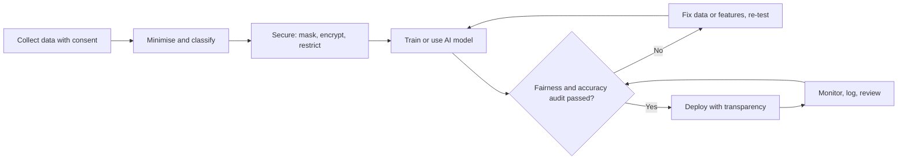
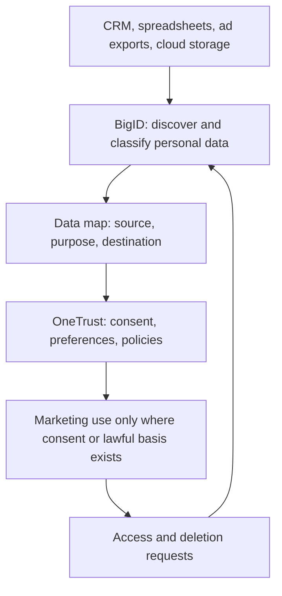
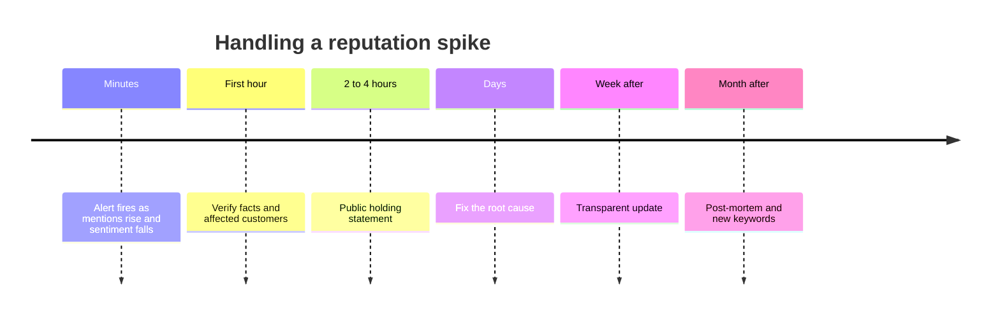
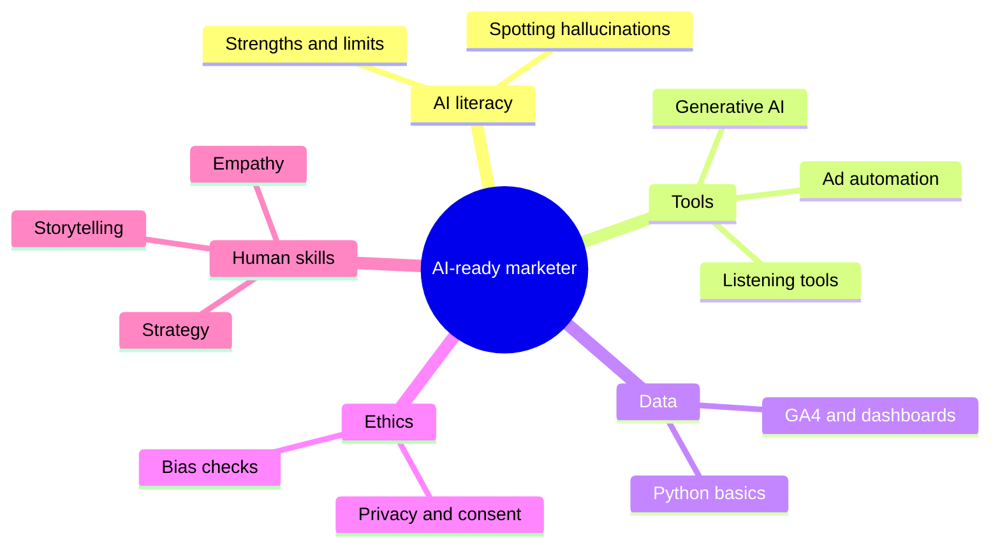
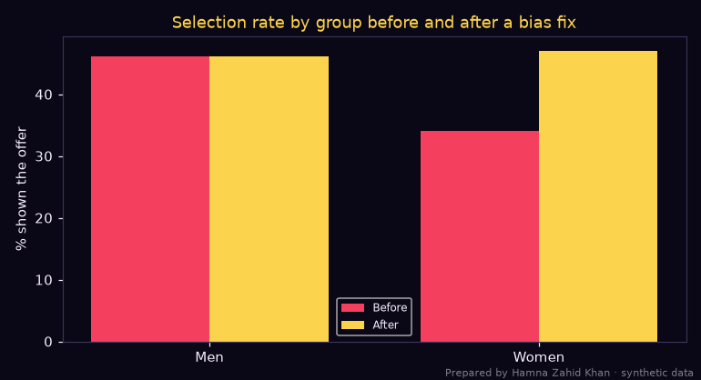
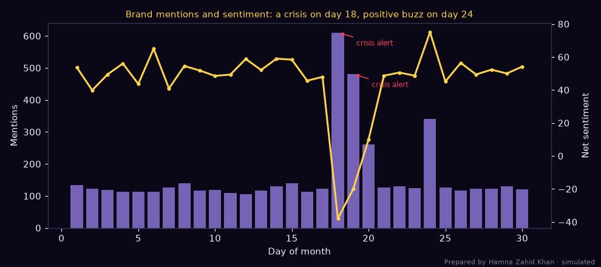
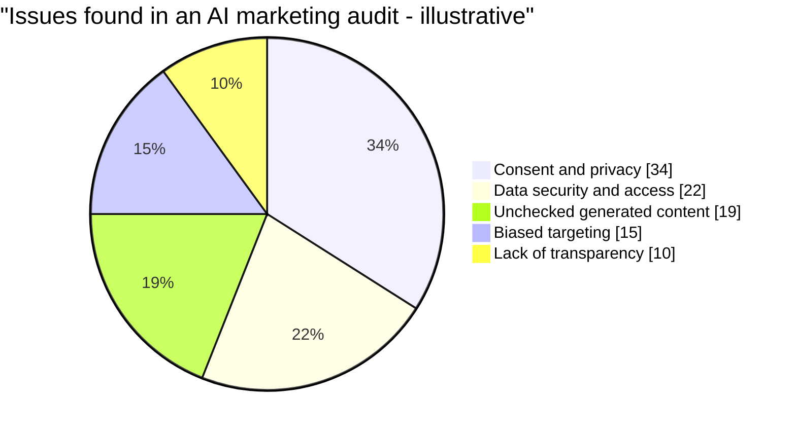

# Session 5 · Ethical AI and Future Trends

> 🏠 [Diploma in Digital Marketing](../../README.md) › [Term 1](../README.md) › [Smart Digital Marketing with AI](README.md) › **Session 5**
>
> ⏱ **Estimated time:** 3 hours (1.5 h theory + 1.5 h lab) · 📋 **Prerequisites:** Sessions 1-4

[⬅ Previous: Session 4](session-04-ai-in-marketing-activities.md) · [Next: Smart Digital Marketing with AI practice test ➡](practice-test.md)

---

## 🎯 Learning objectives

By the end of this session you will be able to:

- Explain the main **ethical challenges** in AI-driven marketing: privacy, data security, bias, transparency, manipulation and responsible use.
- Illustrate how privacy and data-governance tools such as **OneTrust** and **BigID** discover, protect and govern personal data for compliance.
- Monitor **brand reputation** with a listening tool such as **Brand24**, set alerts, and respond ethically to a crisis.
- Define key **emerging trends** in AI marketing and outline strategies for staying ahead.
- List the **AI skills**, ethical responsibilities and career opportunities that prepare you for an AI-driven marketing industry.

## 📖 Concepts

### 1. Why ethics matters in AI marketing

AI makes marketing faster and more personal, but the same power can hurt people if it is used carelessly. Ethics is not only "the right thing to do" – it protects **trust**, avoids **fines and bans**, and keeps your brand out of viral screenshots.

| Challenge | What can go wrong | Marketing example |
|---|---|---|
| **Privacy** | Collecting or using data people did not expect | Using a customer's WhatsApp number from a delivery to add them to promo groups |
| **Data security** | Leaks, weak access control, data in the wrong hands | A lead sheet with CNIC numbers shared as an open Google Sheet link |
| **Bias and fairness** | Models learn unfair patterns from past data | A loan or job ad shown far less often to women for the same eligibility |
| **Transparency** | People don't know AI is involved or why they see something | A chatbot pretending to be a human agent |
| **Manipulation** | Exploiting weaknesses instead of informing | Fake countdown timers, targeting gambling ads at people in debt |
| **Misinformation and deepfakes** | AI content that invents facts or fakes people | An AI "celebrity endorsement" the celebrity never gave |
| **Intellectual property** | Generated content too close to someone else's work | Logos or images copying another artist's style exactly |
| **Accountability** | "The algorithm did it" – nobody owns the decision | Automated rules pausing all ads for a region without review |

### 2. Principles of responsible AI

Most company and government frameworks agree on a similar set of principles. A useful way to remember them is **FATPAS**:

| Principle | In practice for a marketer |
|---|---|
| **Fairness** | Audit targeting and personalisation for different groups (gender, city, age) |
| **Accountability** | A named person approves each AI system and its changes |
| **Transparency** | Tell people when they talk to a bot, label AI-generated media, explain "why am I seeing this ad?" |
| **Privacy** | Collect the minimum data, get consent, honour opt-outs and deletion requests |
| **Accuracy** | Fact-check generated content; monitor model quality over time |
| **Security** | Encrypt, restrict access, mask sensitive fields, log who sees what |

**Privacy by design** means building these into a campaign from the first planning meeting, not adding them after a complaint.

### 3. Privacy law and data protection basics

| Law / rule | Where | Key ideas for marketers |
|---|---|---|
| **GDPR** | EU (applies to anyone targeting EU residents) | Lawful basis, consent, data minimisation, right to access and erasure, fines up to 4% of global turnover |
| **EU AI Act** | EU | Risk-based rules for AI; transparency duties for chatbots and AI-generated content |
| **CCPA / CPRA** | California | Right to know, delete and opt out of "sale or sharing" of data |
| **PECA 2016** | Pakistan | Cybercrime law covering unauthorised access to data, identity misuse and spam-like harassment |
| **Personal data protection bill** | Pakistan (draft, under discussion) | Proposes consent, purpose limitation and a data-protection authority – follow updates |
| **Platform policies** | Meta, Google, TikTok | Rules on special ad categories (credit, jobs, housing), political ads and sensitive targeting |

> 💡 Even where a law is not yet in force, global platforms and international clients expect GDPR-style practice. Following it is the safe default.

**Key terms:** *personal data* (anything identifying a person), *sensitive data* (health, religion, financial, biometric, CNIC), *consent* (freely given, specific, informed and revocable), *data minimisation* (collect only what you need), *retention* (how long you keep it), *data subject request* (a person asking to see or delete their data).

### 4. Privacy and compliance tools – OneTrust and BigID

| Tool | Main job | Features marketers meet |
|---|---|---|
| **OneTrust** | Privacy, consent and trust management | **Cookie consent banners** and preference centres, consent records, data-subject request portals, privacy impact assessments, vendor risk reviews, AI governance inventories |
| **BigID** | Data discovery and intelligence | Uses ML to **scan databases, files and cloud storage** to find and classify personal and sensitive data, map where it flows, flag over-retention and risky access, support deletion requests |

Think of it this way: **BigID finds** the personal data hiding in your systems; **OneTrust manages** the consent and rules for using it. Many companies use both.

**A typical compliance workflow:**

1. **Discover** – scan CRMs, spreadsheets, ad exports and email lists for personal data.
2. **Classify** – label each field (contact, financial, ID, sensitive) and its risk level.
3. **Map** – record where data comes from, where it goes (ad platforms, agencies) and why.
4. **Consent** – collect and store consent with a banner or preference centre; sync opt-outs to email and ad tools.
5. **Protect** – mask or delete what is not needed; restrict access; encrypt.
6. **Respond** – handle access and deletion requests within the legal deadline.
7. **Audit** – review regularly and document decisions.

### 5. Brand reputation monitoring – Brand24

**Brand24** is a media-monitoring tool that tracks mentions of your brand, products, hashtags and competitors across social media, news, blogs, forums, podcasts and reviews. Its AI features include:

| Feature | Use |
|---|---|
| **Mentions feed** | Read every mention in one place, filter by source and sentiment |
| **Sentiment analysis** | Positive, neutral and negative share over time |
| **Volume chart and spike alerts** | Email/Slack alert when mentions suddenly jump |
| **Reach and influence score** | Find the accounts whose posts matter most |
| **Share of voice** | Your share of conversation versus competitors |
| **AI insights / topic analysis** | Summaries of what people are saying and why |

**Ethical reputation management** means fixing the real problem and talking honestly – not deleting fair criticism, buying fake reviews or attacking critics.

**A crisis response playbook:**

| Step | Action | Time |
|---|---|---|
| 1. Detect | Alert fires on volume spike plus sentiment drop | Minutes |
| 2. Verify | Read top mentions; is the claim true? Who is affected? | First hour |
| 3. Hold statement | Acknowledge publicly, promise to investigate | Within 2–4 hours |
| 4. Fix | Product recall, refund, process change | Days |
| 5. Update | Share findings and actions transparently | When ready |
| 6. Learn | Post-mortem; update monitoring keywords and playbook | After recovery |

### 6. Emerging trends in AI marketing

| Trend | What it means | How to stay ahead |
|---|---|---|
| **Generative AI everywhere** | Text, image, video and voice created on demand | Build prompt libraries and brand-voice guides; keep human review |
| **AI agents** | AI that completes multi-step tasks (research, build a campaign, reply to leads) | Start with low-risk tasks; define approval steps |
| **AI search and answer engines** | People get answers from AI assistants instead of ten blue links | Publish clear, factual, well-structured content; build brand authority |
| **Hyper-personalisation** | One-to-one content in real time | Use first- and zero-party data with consent |
| **Privacy-first measurement** | Fewer third-party cookies; modelled conversions | Server-side tracking, consent mode, marketing-mix models |
| **Voice and visual search** | Searching by speaking or photographing a product | Optimise product images and natural-language FAQs, including Urdu |
| **Conversational commerce** | Buying inside WhatsApp and Instagram chats | Catalogue in chat, AI bots with human handover |
| **Synthetic media and virtual influencers** | AI-generated hosts and models | Label clearly; get rights and consent for any real likeness |
| **AI governance** | Companies formally approve and audit AI systems | Keep an AI inventory, risk register and owner for each tool |

### 7. Skills and career opportunities

| Skill area | Examples |
|---|---|
| **AI literacy** | Know what models can and cannot do; spot hallucinations and bias |
| **Prompting and tool fluency** | ChatGPT, Gemini, Jasper, Canva AI, ad-platform automation |
| **Data skills** | Spreadsheets, GA4, SQL basics, Python with pandas, dashboards |
| **Experimentation** | A/B tests, holdouts, reading statistical results |
| **Privacy and ethics** | Consent, data minimisation, platform policies, bias checks |
| **Human strengths** | Strategy, storytelling, cultural insight, empathy, judgement |

**Roles growing in demand:** AI marketing specialist, marketing automation specialist, prompt/content operations lead, marketing data analyst, growth marketer, conversational designer (chatbots), privacy and consent operations specialist, AI governance analyst. In Pakistan, agencies, banks, telecoms, e-commerce and freelance platforms all hire for these skills, and remote work opens international clients.

## 🧭 Diagrams

### From data to responsible AI decision



### OneTrust and BigID in the compliance cycle



### Brand crisis timeline



### Future-ready marketer skills



## 💻 Worked examples

### Example 1 – Discovering and masking personal data (BigID-style)

Before a lead file goes to an agency, scan it for personal data, classify the risk and mask it. Every record here is fake:

📄 `code/session-05_pii_scanner.py`

```python
# Data discovery and masking, the first job of privacy tools such as BigID and OneTrust:
# find personal data hiding in marketing files, classify it, and mask it before sharing.
# Prepared by Hamna Zahid Khan, Junior Lecturer. Every record below is fake.
import re

PATTERNS = {
    "CNIC":   (r"\b\d{5}-\d{7}-\d\b", "high"),
    "Phone":  (r"(?:\+92|0)3\d{2}[- ]?\d{7}\b", "medium"),
    "Email":  (r"\b[\w.+-]+@[\w-]+\.[\w.]+\b", "medium"),
    "Card":   (r"\b(?:\d{4}[- ]?){3}\d{4}\b", "high"),
    "IBAN":   (r"\bPK\d{2}[A-Z]{4}\d{16}\b", "high"),
}
records = [
    "lead_id=101, name=Ayesha K, phone=03001234567, interest=bridal wear",
    "lead_id=102, email=hamza.test@example.com, note='wants EMI, CNIC 42101-1234567-1 sent on WhatsApp'",
    "survey: 'Great service!' rating=5",
    "refund request, card 4111 1111 1111 1111, IBAN PK36SCBL0000001123456702, phone +923211234567",
    "campaign=winter-sale, clicks=420, ctr=2.1%",
]

def mask(kind, value):
    if kind == "Email":
        user, dom = value.split("@"); return user[0] + "***@" + dom
    digits = re.sub(r"\D", "", value)
    return "*" * (len(value) - 4) + value[-4:] if kind != "CNIC" else value[:5] + "-*******-" + value[-1]

found = {k: 0 for k in PATTERNS}
risky_rows = 0
for i, rec in enumerate(records, 1):
    hits, clean = [], rec
    for kind, (pat, risk) in PATTERNS.items():
        for m in re.findall(pat, rec):
            hits.append(f"{kind}({risk})"); found[kind] += 1
            clean = clean.replace(m, mask(kind, m))
    risky_rows += bool(hits)
    print(f"Row {i}: {hits or 'no personal data'}")
    if hits: print(f"   masked -> {clean}")
print("\nInventory:", {k: v for k, v in found.items() if v})
print(f"{risky_rows}/{len(records)} rows contain personal data -> restrict access, set retention, record a lawful basis")
```

**Output**

```text
Row 1: ['Phone(medium)']
   masked -> lead_id=101, name=Ayesha K, phone=*******4567, interest=bridal wear
Row 2: ['CNIC(high)', 'Email(medium)']
   masked -> lead_id=102, email=h***@example.com, note='wants EMI, CNIC 42101-*******-1 sent on WhatsApp'
Row 3: no personal data
Row 4: ['Phone(medium)', 'Card(high)', 'IBAN(high)']
   masked -> refund request, card ***************1111, IBAN ********************6702, phone *********4567
Row 5: no personal data

Inventory: {'CNIC': 1, 'Phone': 2, 'Email': 1, 'Card': 1, 'IBAN': 1}
3/5 rows contain personal data -> restrict access, set retention, record a lawful basis
```

**What this teaches:** personal data hides in "notes" and "free text" fields, not only in columns called *phone* or *email*. Row 2 contains a CNIC sent over WhatsApp inside a note – high-risk data that should never have been in a marketing file. Real tools like BigID use the same idea (patterns plus machine-learning classifiers) across millions of records and many systems, then feed the results into policies, retention rules and deletion workflows.

### Example 2 – Auditing an AI targeting model for bias

A model decides who sees a loan-offer ad. Both groups are equally creditworthy, but the model learned from historical data where women were under-served:

📄 `code/session-05_bias_audit.py`

```python
# Auditing an AI targeting model for unfair outcomes: compare who gets shown a loan-offer ad by group,
# using selection rate, the "four-fifths" disparate-impact ratio and error rates.
# Prepared by Hamna Zahid Khan, Junior Lecturer. Synthetic applicants; groups are illustrative.
import numpy as np
import matplotlib
matplotlib.use("Agg")
import matplotlib.pyplot as plt

BG, FIRE, GOLD, VIOLET, EMBER, TEXT = "#0A0716", "#FF6B1A", "#FCD34D", "#A78BFA", "#F43F5E", "#F5EEFF"
rng = np.random.default_rng(21)
N = 4000
group = rng.choice(["Men", "Women"], N, p=[0.6, 0.4])
creditworthy = rng.binomial(1, 0.5, N)          # truly eligible: same 50% in both groups
# A model trained on historical data where women were under-served scores them lower for the same eligibility
score = 0.35 + 0.35 * creditworthy + rng.normal(0, 0.12, N) - 0.10 * (group == "Women")
shown = score > 0.55

def audit(shown_mask, label):
    print(label)
    rates = {}
    for g in ["Men", "Women"]:
        m = group == g
        sel = shown_mask[m].mean()
        tpr = shown_mask[m & (creditworthy == 1)].mean()   # eligible people who were shown the offer
        rates[g] = sel
        print(f"  {g:<6} selection rate {sel:.1%}   eligible people reached (TPR) {tpr:.1%}")
    di = rates["Women"] / rates["Men"]
    print(f"  Disparate-impact ratio = {di:.2f}  ->  {'FAILS' if di < 0.8 else 'passes'} the four-fifths (0.80) rule\n")
    return rates

before = audit(shown, "BEFORE mitigation (one threshold for everyone):")
# Mitigation used here for teaching: remove the biased adjustment by re-scoring without group effect.
# In real projects you would fix the training data/features and re-validate, not just move thresholds.
score_fixed = score + 0.10 * (group == "Women")
after = audit(score_fixed > 0.55, "AFTER mitigation (biased feature removed and model re-scored):")

fig, ax = plt.subplots(figsize=(7, 3.8), facecolor=BG); ax.set_facecolor(BG)
x = np.arange(2)
ax.bar(x - 0.18, [before["Men"] * 100, before["Women"] * 100], 0.36, color=EMBER, label="Before")
ax.bar(x + 0.18, [after["Men"] * 100, after["Women"] * 100], 0.36, color=GOLD, label="After")
ax.set_xticks(x); ax.set_xticklabels(["Men", "Women"], color=TEXT)
ax.set_ylabel("% shown the offer", color=TEXT)
ax.set_title("Selection rate by group before and after a bias fix", color=GOLD)
ax.tick_params(colors=TEXT)
for sp in ax.spines.values(): sp.set_color("#3b3355")
ax.legend(facecolor=BG, labelcolor=TEXT, fontsize=8)
fig.text(0.99, 0.01, "Prepared by Hamna Zahid Khan · synthetic data", color=TEXT, alpha=0.5, ha="right", fontsize=7)
plt.tight_layout(); plt.savefig("session-05_bias_audit.png", dpi=110, facecolor=BG)
print("Saved session-05_bias_audit.png")
```

**Output**

```text
BEFORE mitigation (one threshold for everyone):
  Men    selection rate 46.2%   eligible people reached (TPR) 89.7%
  Women  selection rate 34.1%   eligible people reached (TPR) 67.7%
  Disparate-impact ratio = 0.74  ->  FAILS the four-fifths (0.80) rule

AFTER mitigation (biased feature removed and model re-scored):
  Men    selection rate 46.2%   eligible people reached (TPR) 89.7%
  Women  selection rate 47.0%   eligible people reached (TPR) 90.7%
  Disparate-impact ratio = 1.02  ->  passes the four-fifths (0.80) rule

Saved session-05_bias_audit.png
```



**How to read it:**

| Metric | Meaning | Before | After |
|---|---|---|---|
| Selection rate (women ÷ men) | **Disparate-impact ratio** – below 0.80 is a red flag (the "four-fifths rule") | 34.1 ÷ 46.2 = **0.74** ❌ | 47.0 ÷ 46.2 = **1.02** ✅ |
| Eligible women reached (TPR) | Of truly eligible women, how many saw the offer | 67.7% | 90.7% |

Nearly **one in three eligible women** was missed before the fix. That is unfair, can break platform rules for credit ads, and is also lost revenue. In real projects you fix the cause (biased training data or proxy features such as certain neighbourhoods) and re-test – then keep auditing every month.

### Example 3 – Brand reputation monitoring with alerts (Brand24-style)

Thirty days of simulated mentions for a cosmetics brand. An alert fires only when volume is more than double the 7-day average **and** net sentiment falls 20+ points:

📄 `code/session-05_brand_monitor.py`

```python
# Brand-reputation monitoring in the style of Brand24: daily mention volume and sentiment,
# with an automatic alert when volume spikes AND sentiment drops. Prepared by Hamna Zahid Khan, Junior Lecturer.
# 30 days of simulated mentions for an illustrative Pakistani cosmetics brand.
import numpy as np
import matplotlib
matplotlib.use("Agg")
import matplotlib.pyplot as plt

BG, FIRE, GOLD, VIOLET, EMBER, TEXT = "#0A0716", "#FF6B1A", "#FCD34D", "#A78BFA", "#F43F5E", "#F5EEFF"
rng = np.random.default_rng(9)
days = np.arange(1, 31)
volume = rng.poisson(120, 30)
pos_share = np.clip(rng.normal(0.62, 0.04, 30), 0, 1)
neg_share = np.clip(rng.normal(0.12, 0.03, 30), 0, 1)
# Day 18: an influencer posts about a skin reaction; day 24: a positive charity campaign
volume[17:20] = [610, 480, 260]; neg_share[17:20] = [0.58, 0.47, 0.30]; pos_share[17:20] = [0.20, 0.27, 0.40]
volume[23] = 340; pos_share[23] = 0.80; neg_share[23] = 0.05

net = (pos_share - neg_share) * 100
alerts = []
for d in range(7, 30):
    base_v, base_net = volume[d - 7:d].mean(), net[d - 7:d].mean()
    if volume[d] > 2 * base_v and net[d] < base_net - 20:
        alerts.append(d + 1)
        print(f"ALERT day {d + 1}: volume {volume[d]} (7-day avg {base_v:.0f}), net sentiment {net[d]:+.0f} (avg {base_net:+.0f})")
    elif volume[d] > 2 * base_v:
        print(f"Spike day {d + 1}: volume {volume[d]} with net sentiment {net[d]:+.0f} -> positive buzz, amplify it")
print(f"\nMonth: {volume.sum():,} mentions, average net sentiment {net.mean():+.1f}")
# reach-weighted share of voice vs two competitors (illustrative monthly totals)
sov = {"Our brand": volume.sum(), "Competitor X": 3900, "Competitor Y": 2600}
tot = sum(sov.values())
print("Share of voice: " + ", ".join(f"{k} {v / tot:.0%}" for k, v in sov.items()))

fig, ax1 = plt.subplots(figsize=(9, 4), facecolor=BG); ax1.set_facecolor(BG)
ax1.bar(days, volume, color=VIOLET, alpha=0.7, label="Mentions")
ax2 = ax1.twinx()
ax2.plot(days, net, color=GOLD, lw=2, marker="o", ms=3, label="Net sentiment")
for a in alerts:
    ax1.annotate("crisis alert", (a, volume[a - 1]), xytext=(a + 1.2, volume[a - 1] - 40), color=EMBER,
                 arrowprops=dict(arrowstyle="->", color=EMBER), fontsize=8)
ax1.set_xlabel("Day of month", color=TEXT); ax1.set_ylabel("Mentions", color=TEXT); ax2.set_ylabel("Net sentiment", color=TEXT)
ax1.set_title("Brand mentions and sentiment: a crisis on day 18, positive buzz on day 24", color=GOLD, fontsize=10)
for a in (ax1, ax2):
    a.tick_params(colors=TEXT)
    for sp in a.spines.values(): sp.set_color("#3b3355")
fig.text(0.99, 0.01, "Prepared by Hamna Zahid Khan · simulated", color=TEXT, alpha=0.5, ha="right", fontsize=7)
plt.tight_layout(); plt.savefig("session-05_brand_monitor.png", dpi=110, facecolor=BG)
print("Saved session-05_brand_monitor.png")
```

**Output**

```text
ALERT day 18: volume 610 (7-day avg 120), net sentiment -38 (avg +53)
ALERT day 19: volume 480 (7-day avg 191), net sentiment -20 (avg +41)

Month: 4,865 mentions, average net sentiment +45.2
Share of voice: Our brand 43%, Competitor X 34%, Competitor Y 23%
Saved session-05_brand_monitor.png
```



**Interpretation:** day 18 is a genuine **crisis** (an influencer's skin-reaction post): volume ×5 and sentiment fell from about +53 to −38. Day 24 also spiked (a charity campaign) but did **not** alert because sentiment rose – a smart alert needs both conditions, or the team learns to ignore it. Ethical response: verify the complaint, pause the product batch if needed, contact the affected customer privately, publish a clear statement, and never flood the conversation with paid praise.

### Example 4 – Walkthrough: setting up Brand24 for a client (lab)

1. **Create a project** with keywords: brand name, common misspellings, Urdu and Roman Urdu spellings, product names, campaign hashtags, the CEO's name.
2. **Exclude noise** – add excluded words (e.g. a brand called "Glow" excludes "glow sticks").
3. **Add competitors** as separate projects to compare share of voice.
4. **Set alerts** – mention spikes, negative mentions from high-influence accounts, daily summary email.
5. **Review the dashboard** weekly: volume, sentiment, top sources, influencers, topics.
6. **Report** – monthly PDF with insights and actions (not just charts).

**Sample calculation – share of voice:** our brand 4,865 mentions, competitor X 3,850, competitor Y 2,600. Total = 11,315. Our SOV = 4,865 ÷ 11,315 ≈ **43%**.

### Example 5 – Walkthrough: a consent banner and preference centre (OneTrust-style)

1. **Scan the website** for cookies and tags (analytics, ads pixels, chat widgets) and group them: strictly necessary, analytics, marketing, personalisation.
2. **Design the banner** with equal "Accept all" and "Reject all" buttons and a "Manage preferences" link – no pre-ticked boxes.
3. **Connect tags** so marketing pixels fire only after consent (Google Consent Mode, tag manager triggers).
4. **Preference centre** – let subscribers choose topics and frequency (e.g. "sale alerts only, weekly").
5. **Record and sync** – store consent proof; sync email opt-outs to the CRM and ad audiences.
6. **Measure** – consent rate by device; if it is 55%, expect analytics and retargeting audiences to shrink and use modelled conversions.

**Worked numbers:** 40,000 monthly visitors × 55% consent = 22,000 trackable visitors. A retargeting audience built on them is 45% smaller than before – plan budgets on the honest number.

## 📊 Chart · Where ethical risk comes from in AI marketing (illustrative audit of 100 issues)



## 📋 Checklist · Ethical AI campaign review

- [ ] Purpose of each data field written down; nothing collected "just in case".
- [ ] Consent recorded and opt-outs synced to every tool.
- [ ] Sensitive data (CNIC, card, health, religion) excluded or masked.
- [ ] Targeting and personalisation audited for unfair group differences.
- [ ] AI-generated text and images fact-checked and labelled where required.
- [ ] Chatbots disclose they are bots and offer a human.
- [ ] No fake reviews, fake urgency or deceptive deepfakes.
- [ ] Brand monitoring and crisis playbook in place, with named owners.
- [ ] A named person accountable for each AI system.

## ⚠️ Common mistakes

| Mistake | Fix |
|---|---|
| "The data was public, so it's fine to use" | Public does not mean consented for marketing; check purpose and platform rules |
| Sharing lead files over WhatsApp or open links | Use access-controlled storage and mask personal data |
| Testing a model only on overall accuracy | Break results down by group; check the four-fifths ratio |
| Hiding that content or a chat is AI | Disclose clearly |
| Alerts on volume only | Combine volume and sentiment so alerts stay meaningful |
| Deleting criticism or buying reviews | Respond honestly and fix the root cause |
| Chasing every new AI tool | Pick tools that solve a real problem and meet your privacy standards |

## ✅ Best practices

- Run a short **privacy impact assessment** before any new AI-driven campaign.
- Keep an **AI inventory**: tool, purpose, data used, owner, review date.
- Monitor brand mentions **daily**, report **monthly**, rehearse the crisis playbook **twice a year**.
- Spend a few hours a month learning: newsletters, platform release notes, short courses and hands-on experiments.

## 🧪 Lab / practice tasks

**Task 1 (easy) – Spot the problem.** For each case, name the ethical issue: (a) a chatbot introduces itself as "Sara from customer care" with no bot disclosure; (b) a lead form asks for CNIC to download a free e-book; (c) a fake "only 2 left!" message that never changes.

<details><summary>✅ Solution</summary>

(a) **Transparency** – disclose that it is a bot. (b) **Privacy / data minimisation** – CNIC is sensitive and not needed for an e-book. (c) **Manipulation** – false urgency (a "dark pattern").

</details>

**Task 2 (easy) – Four-fifths rule.** An ad is shown to 30% of men and 21% of women. Calculate the disparate-impact ratio and decide if it passes.

<details><summary>✅ Solution</summary>

21 ÷ 30 = **0.70**, below 0.80 → **fails**; investigate the targeting.

</details>

**Task 3 (medium) – Extend the scanner.** Add a pattern to `code/session-05_pii_scanner.py` for dates of birth in the form `DD-MM-YYYY` and classify it as "medium". Test with a new record "dob=14-12-2000, city=Karachi".

<details><summary>💡 Hint</summary>

Use `r"\b\d{2}-\d{2}-\d{4}\b"`. Be careful: the CNIC pattern also contains dashes – run the scanner and check you do not double-count.

</details>

**Task 4 (medium) – Tune the alert.** In `code/session-05_brand_monitor.py`, change the volume rule from "2× the 7-day average" to "1.5×". Which extra days alert? Is that better or worse for the team?

<details><summary>💡 Hint</summary>

A lower threshold catches crises earlier but creates more false alarms. Look at whether new alerts also have a real sentiment drop; alerts people ignore are worse than no alerts.

</details>

**Task 5 (challenge) – Ethics policy.** Write a one-page "Responsible AI in Marketing" policy for a Karachi e-commerce startup: principles, what data may be used, approval steps for AI content, bias checks, crisis response and who is accountable.

**Task 6 (challenge) – Future-skills plan.** List three AI-marketing roles you find interesting, the skills each needs, and a 3-month learning plan with one portfolio project per month.

## ✅ Quick quiz

1. BigID is mainly used to:
   a) design logos b) discover and classify personal data across systems c) run Google Ads d) send SMS
2. OneTrust is best known for:
   a) cookie consent and privacy management b) video editing c) SEO audits d) payroll
3. A disparate-impact ratio of 0.74 means:
   a) the model is perfectly fair b) the lower group is selected at less than four-fifths the rate of the higher group – a red flag c) data is encrypted d) the campaign is profitable
4. A good brand-crisis alert should trigger when:
   a) any mention appears b) volume spikes and sentiment drops together c) the logo changes d) followers increase
5. Which is a **transparency** practice?
   a) hiding that a chat is automated b) labelling AI-generated images and disclosing bots c) buying reviews d) collecting extra data "just in case"

<details><summary>Show answers</summary>

1-b · 2-a · 3-b · 4-b · 5-b

</details>

## 📝 Summary

- AI marketing raises **privacy, security, bias, transparency, manipulation and accountability** challenges – remember **FATPAS**.
- Follow **privacy by design**: consent, data minimisation, security and honest disclosure, guided by GDPR-style practice and local law.
- **BigID** discovers and classifies personal data; **OneTrust** manages consent, preferences and compliance workflows.
- **Brand24** tracks mentions, sentiment and share of voice; smart alerts combine volume and sentiment; respond honestly.
- Trends: generative AI, AI agents, AI search, hyper-personalisation, privacy-first measurement, conversational commerce and AI governance.
- Future-ready marketers combine **AI literacy, data skills and ethics** with human strategy and creativity.

**Interview / viva questions**

1. What ethical risks come with AI-powered personalisation, and how do you reduce them?
2. Explain the difference between what BigID and OneTrust do.
3. How would you detect bias in an ad-targeting model? Explain the four-fifths rule.
4. Walk through your first 24 hours of a brand reputation crisis.
5. Which AI trend will change digital marketing most in the next three years, and how would you prepare?
6. What does "privacy by design" mean for a lead-generation campaign?

---

[⬅ Previous: Session 4](session-04-ai-in-marketing-activities.md) · [Next: Smart Digital Marketing with AI practice test ➡](practice-test.md)

<sub>Prepared by **Hamna Zahid Khan**, Junior Lecturer · Diploma in Digital Marketing</sub>
